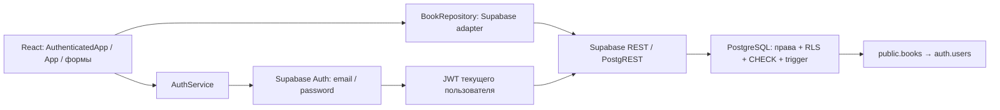

# ДЗ5 — Развертывание Backend и интеграция с Frontend

[Навигация](README.md) · [Запуск](../README.md) · [Исходное ДЗ5](original.txt) · [ТЗ](technical_specification.md)

Дата: 15.10.2026 (Europe/Moscow). Цель — спроектировать PostgreSQL, подготовить
развёртывание Supabase и связать существующий frontend с Auth и CRUD API.

**Статус: реализация и доступные проверки девяти шагов выполнены.** Код, миграция,
локальные SQL/SDK/UI-тесты и отчёт подготовлены. Владелец применил SQL; реальный
Supabase проверен: 33 API/RLS-проверки двумя обычными подтверждёнными пользователями
и 14 проверок production UI без HTTP-подмены прошли. Сохранность данных после
перезагрузки и повторного входа подтверждена. Новые тестовые книги удалены.
Первоначальная ошибка `PGRST205` устранена, anon получает `401 / 42501`.
Применение миграции подтверждено владельцем 15.10.2026: «Подтверждаю; выполню SQL и сообщу результат».
Результат SQL Editor сообщён владельцем: «Успех». Повторное выполнение миграции не производилось.
Права на SELECT для anon проверены запросом; каталоги RLS/Policies через Dashboard агент не просматривал.
Аккаунты подготовлены пользователем; Auth подтвердил email_confirmed_at обоих.
Регистрация и получение письма не наблюдались автоматизацией, административного
SQL-доступа и Dashboard в сессии нет. Publishable key не даёт права применять DDL
или читать Logs. Публикация GitHub и ручные ограничения раскрыты ниже.

## Источники и согласование требований

Исходное задание найдено в `docs/original.txt`, строки 636–845: девять шагов,
обязательный файл `backend_documentation.md`, миграции, `.env.example`, GitHub
и работающее приложение либо инструкции запуска. Название выше повторяет оригинал.
Контекст: project_description, technical_specification, user_stories,
rules/hw_ai_rules, UI-концепция Minimal Library и development_report ДЗ4.

Противоречия разрешены минимально: ограничения «только mock» относятся к ДЗ4;
в ДЗ5 заменён адаптер, UI сохранён. ДЗ4 реализовало все четыре операции раньше
минимального плана — они сохранены. Требование «создать проект Supabase» уже
выполнено владельцем, повторное создание не нужно. `Book.user_id` теперь обязателен,
фикстуры ДЗ4 дополнены фиктивным владельцем. UUID назначает БД; автоматический
повтор записи запрещён при неопределённом результате, как требует ТЗ.
Упоминание Docker/PostgREST в теме занятия не требует собственного Docker при BaaS.
Скриншоты необязательны; включены только фактически полученные локальные изображения.

## Архитектура и выбор инфраструктуры



Supabase соответствует небольшому MVP: готовые PostgreSQL, Auth, REST, RLS и
Dashboard Logs. Self-hosted потребовал бы обслуживать сервер, TLS, Docker,
обновления и аутентификацию без пользы для текущих функций. Отдельных Express,
NestJS, VPS, proxy, предметных таблиц и глобального состояния не добавлено.
Компромисс — зависимость от сервиса и необходимость проверить Dashboard-настройки.

## Схема данных и ограничения

Одна предметная таблица `public.books`, N:1 к управляемой Supabase `auth.users`.

| Поле | PostgreSQL | Ограничение |
| --- | --- | --- |
| id | uuid | PK, default gen_random_uuid(), неизменяемый |
| user_id | uuid | NOT NULL, default auth.uid(), FK auth.users(id), ON DELETE CASCADE |
| title | text | NOT NULL, trim, 1–200 единиц UTF-16 |
| author | text | NOT NULL, trim, 1–120 единиц UTF-16 |
| status | text | NOT NULL, default want_to_read; CHECK: want_to_read / reading / finished |
| rating | integer NULL | NULL или 1–5 исключительно при finished |
| notes | text NULL | trim, пустая → NULL, до 1000 единиц UTF-16 |
| created_at | timestamptz | NOT NULL, автоматически now(); неизменяемая |
| updated_at | timestamptz | NOT NULL; при UPDATE clock_timestamp() |

`booktrack_trim` повторяет перечень пробельных символов JavaScript String.trim,
включая NBSP/BOM. `booktrack_utf16_length` считает символ вне BMP за две единицы,
пустую строку за ноль. Trigger нормализует текст и выставляет даты до CHECK.
DB отклоняет ненулевой rating при reading, даже если запрос обходит UI.
Форма при уходе из finished очищает rating с пояснением. Дубли title/author разрешены.
Один индекс `(user_id, created_at DESC, id)` поддерживает RLS/список и FK-проверки
удаления пользователя; дополнительных индексов поиска нет.

## Миграция и права

Полный проверяемый SQL:
[20261015000100_create_books.sql](../supabase/migrations/20261015000100_create_books.sql).
Миграция создаёт таблицу, три вспомогательные функции, trigger, индекс, четыре
политики, включает ENABLE/FORCE RLS и устанавливает права. Всё в одной транзакции.
Нет DROP, TRUNCATE, массовых DELETE или обновления существующих данных.
При совпадении объектов CREATE завершится ошибкой и откатит транзакцию;
существующая таблица намеренно не принимается без проверки через IF NOT EXISTS.
Локально проверено, что повторный запуск останавливается, не теряя записи.

| Операция / роль | Права и политика |
| --- | --- |
| SELECT authenticated | USING ((select auth.uid()) = user_id) |
| INSERT authenticated | Только title/author/status/rating/notes; WITH CHECK auth.uid() = user_id |
| UPDATE authenticated | Те же пять полей; USING и WITH CHECK auth.uid() = user_id |
| DELETE authenticated | USING auth.uid() = user_id |
| anon / PUBLIC | Нет прав на таблицу, CRUD отклоняется |

Владелец берётся из JWT через default auth.uid(); браузеру не разрешён INSERT
или UPDATE user_id/id/дат. Trigger дополнительно запрещает изменение идентичности
записи. Политики действуют и без фильтра frontend. Чужие SELECT/UPDATE/DELETE
обычно дают ноль строк; это не требует буквального 403. Попытка подмены владельца
даёт `42501` уже на уровне прав столбцов. Это дополнительная защита поверх RLS.
Нет SECURITY DEFINER-функций и RPC, позволяющих обходить изоляцию.

## Развёртывание и подтверждение миграции

**Применение этого файла подтверждено владельцем 15.10.2026. Повторное подтверждение не требуется.**
Владелец сообщил «Успех» после выполнения через SQL Editor. Повторная read-only
проверка выполнена: anon SELECT — HTTP 401, PostgreSQL code 42501; Auth и OPTIONS — HTTP 200.
**Миграцию повторно не выполнять.** Нижеследующая инструкция сохранена для нового проекта
и проверки каталогов; она не является поручением повторить уже выполненный SQL.
Supabase CLI и psql не установлены, привязки проекта в репозитории нет.
Не запрашиваются service_role, secret key или пароль БД.

1. В существующем проекте Dashboard → SQL Editor выполните только чтение:

```sql
select to_regclass('public.books') as books;
select proname from pg_proc p join pg_namespace n on n.oid = p.pronamespace
where n.nspname = 'public' and proname like 'booktrack_%';
select tablename, policyname, cmd, roles, qual, with_check
from pg_policies where schemaname = 'public' and tablename = 'books';
```

2. Если таблица/одноимённые функции уже есть, не применяйте миграцию. Сверьте
   определение, grants, RLS и историю; подготовьте отдельную неразрушающую миграцию.
   `PGRST205` доказывает отсутствие таблицы в REST-кэше, но не заменяет эту проверку.
3. Просмотрите полный SQL по ссылке выше. Применение именно этого файла уже подтверждено владельцем.
4. После подтверждения откройте новый SQL-запрос, вставьте файл целиком и нажмите Run.
   Сохраните результат. Если транзакция завершилась ошибкой, выполните ROLLBACK,
   изучите причину; успешный файл повторно не запускайте.
5. После успеха проверьте Database → Tables и RLS/Policies, затем SQL:

```sql
select relrowsecurity, relforcerowsecurity
from pg_class where oid = 'public.books'::regclass;
select policyname, cmd, roles, qual, with_check from pg_policies
where schemaname = 'public' and tablename = 'books';
select grantee, privilege_type from information_schema.role_table_grants
where table_schema = 'public' and table_name = 'books';
select grantee, column_name, privilege_type from information_schema.column_privileges
where table_schema = 'public' and table_name = 'books'
and grantee in ('anon', 'authenticated');
```

6. `npm run check:supabase` должен показать отказ anon `42501`, а не `PGRST205`.
   Затем выполните live-тест ниже. Фактическую дату/успех применения занесите сюда.
   Фактический результат: **владелец сообщил об успехе; REST проверен — anon 401/42501**.
   Последующая live-проверка двух обычных аккаунтов прошла: чужой SELECT/UPDATE/DELETE
   в обоих направлениях, подмена владельца и анонимный CRUD запрещены.
   SQL из SQL Editor сам по себе не
   записывает версию в CLI migration history; при будущем подключении CLI сначала
   согласуйте историю с уже применённым файлом, чтобы не выполнить его второй раз.

## Supabase Auth

Используются штатные signUp, signInWithPassword, signOut(scope: local),
getSession, getUser и onAuthStateChange. Один клиент на приложение;
persistSession/autoRefreshToken/detectSessionInUrl включены.
Восстановленный пользователь проверяется getUser до открытия библиотеки.
Auth callback синхронный, без вложенных SDK-await, подписка снимается при unmount.
Сессия SDK хранится стандартным способом в localStorage; пароли приложение не
сохраняет. Это браузерный SPA без серверных HttpOnly cookies. Защита от XSS важна.

Настройте Authentication → Providers → Email (включён), подтверждение email
(по реальному settings-запросу **включено**); не отключайте его ради тестов.
Authentication → URL Configuration: Site URL и allowlist Redirect URLs должны
содержать фактический origin frontend. Для локального запуска это
`http://127.0.0.1:5173`; localhost и 127.0.0.1 — разные origins. Для preview
при необходимости добавьте `http://127.0.0.1:4173`. Адрес будущего хостинга
добавляется после его появления. redirectTo регистрации равен window.location.origin.

Регистрация без session показывает инструкцию проверить письмо; это не успешный
вход. Неправильный пароль, неподтверждённый email и лимит попыток имеют безопасные
сообщения. Ошибка сети при выходе показывается; успех выхода не объявляется до SDK.
JWT expiry без refresh скрывает библиотеку по таймеру, 401/невалидный JWT также
сбрасывает интерфейс. Смена пользователя перемонтирует App с ключом user.id и
удаляет старые книги, фильтры и формы. Запоздалый отказ старого аккаунта не
завершает новую сессию. OAuth и собственное хранение паролей отсутствуют.

## CRUD и API

Все вызовы SDK находятся в `src/data/`. React использует прежний BookRepository;
BookForm/BookCard не знают о Supabase. Тип Database сопоставлен с общей моделью,
вход/сетевые ответы дополнительно валидируются во время исполнения.

| HTTP | Endpoint относительно project URL | Результат |
| --- | --- | --- |
| POST | /auth/v1/signup | Регистрация; session может отсутствовать до подтверждения |
| POST | /auth/v1/token?grant_type=password | Вход; SDK управляет токенами |
| GET | /auth/v1/user | Проверка пользователя |
| POST | /auth/v1/logout?scope=local | Выход из текущей сессии |
| GET | /rest/v1/books?select=*&user_id=eq.USER_UUID&order=created_at.desc,id.asc | Свои книги |
| POST | /rest/v1/books | Создание, Prefer: return=representation |
| PATCH | /rest/v1/books?id=eq.BOOK_UUID&user_id=eq.USER_UUID | Изменение, возвращает одну запись |
| DELETE | /rest/v1/books?id=eq.BOOK_UUID&user_id=eq.USER_UUID&select=id | Удаление с подтверждением id |

SDK передаёт apikey и Authorization с пользовательской сессией. Клиентский
owner-filter полезен, но не заменяет RLS. Список загружается страницами по 500,
чтобы default REST cap не обрезал поиск; поиск/фильтр применяются ко всему списку.
Обновление/удаление проверяют ровно одну запись/id; отсутствующая/чужая запись
одинаково недоступна. UPDATE никогда не выполняет upsert. Сохранённые значения
сверяются с отправленными. Повторные клики блокируются синхронным lock.

Пример использования (синтетические данные, не фактический запрос сессии):

```ts
const input = {
  title: 'Новая книга', author: 'Автор', status: 'want_to_read' as const,
  rating: null, notes: null,
};
await repository.create(input);
await repository.list();
await repository.update('20000000-0000-4000-8000-000000000001', {
  ...input, status: 'finished', rating: 5,
});
await repository.remove('20000000-0000-4000-8000-000000000001');
```

Пример JSON тела POST (id/владелец/даты не отправляются):

```json
{"title":"Новая книга","author":"Автор","status":"want_to_read","rating":null,"notes":null}
```

Пример ожидаемой REST representation, **не результат live-проверки**:

```json
[{"id":"20000000-0000-4000-8000-000000000001","user_id":"10000000-0000-4000-8000-000000000001","title":"Новая книга","author":"Автор","status":"want_to_read","rating":null,"notes":null,"created_at":"2026-10-15T00:00:00Z","updated_at":"2026-10-15T00:00:00Z"}]
```

## Окружение, CORS и безопасность

`.env.local` существует; проверены только имена и наличие двух VITE-переменных.
Значения не печатались и не копировались. `.gitignore` исключает `.env*` и `*.local`,
исключение — `.env.example` с фиктивными значениями. Файл окружения не отслеживается
Git. `import.meta.env` используется только в фабрике клиента; конфигурация с
sb_secret_/service_role отвергается, разрешён только sb_publishable_.

Проверен реальный OPTIONS REST: HTTP 200, Access-Control-Allow-Origin `*`,
разрешены GET/POST/PATCH/DELETE и нужные методы preflight. Для стандартного
Supabase REST не нужен самодельный proxy или настройка Vite CORS. Этот API
использует заголовок Bearer, а не cross-origin cookie. Auth Redirect URL allowlist
настраивается отдельно и не является CORS. CORS ограничивает браузерное
взаимодействие; RLS/права ограничивают данные и действуют также для curl/SDK.
Wildcard CORS не делает личные записи публичными при корректных grants/RLS.
Основания: [Supabase RLS](https://supabase.com/docs/guides/database/postgres/row-level-security),
[API keys](https://supabase.com/docs/guides/getting-started/api-keys),
[Auth passwords](https://supabase.com/docs/guides/auth/passwords),
[Auth events](https://supabase.com/docs/reference/javascript/auth-onauthstatechange).

React отображает заметки как текст; dangerouslySetInnerHTML/eval отсутствуют.
Фильтры REST строит SDK, SQL из пользовательских строк не формируется.
Административные секреты frontend не использует. Логи не содержат email, паролей,
токенов, URL проекта, названий книг и заметок. Локальная публикация окружения не
требуется. Изменения Git не закоммичены и не отправлены автоматически.

## Ошибки, состояния и диагностика

BackendError имеет категории validation / unauthenticated / unavailable /
network / unexpected. Учитываются status и реальные SDK/PostgREST code:
invalid_credentials, email_not_confirmed, 23514/23502/22P02, 42501,
PGRST301–303, ошибки refresh token и другие. Сырые SQL/details/stack trace
пользователю не передаются. Повреждённый ответ не превращается в пустую библиотеку.
Проверены loading/empty/error/success, сохранение черновика после отказа и повтор.

Сетевой сбой/500/невалидная representation после записи может означать, что запись
уже выполнена. В таком случае успех не объявляется и кнопка «Сохранить»/«Удалить»
блокируется до закрытия формы: пользователь обновляет список и решает, нужен ли
новый ввод. Автоповтора нет. При явной validation-ошибке повтор доступен.
Приложение не обещает идемпотентность по названию/автору: дубли разрешены.

Безопасный клиентский log: `[BookTrack] { operation: 'create', category: 'network' }`.
Служебные логи Supabase ведёт платформа; их просмотр в этой сессии недоступен.
Фактический анализ Dashboard Logs не заявляется. Для отладки откройте Logs →
API Gateway/PostgREST, Auth и Postgres (названия разделов зависят от Dashboard),
выберите время запроса, HTTP status, code и request ID. В DevTools Network
сопоставьте endpoint/метод/статус, но не копируйте Authorization, apikey, пароль
или тело личных записей в скриншот/чат. Уберите эти поля перед передачей AI.

| Проблема | Проверка и действие |
| --- | --- |
| PGRST205 / 404 books | `npm run check:supabase`; SQL to_regclass; миграция/REST schema cache |
| 401 / PGRST301 | Auth Logs: срок JWT, refresh; повторный вход, без отключения RLS |
| 403 / 42501 | SQL grants/column_privileges и Policies, правильная пользовательская сессия |
| Ноль строк чужого id | Ожидаемая RLS-изоляция, не пытаться делать upsert |
| 23514 / 23502 | CHECK/NOT NULL, пробельный title, UTF-16 длины и rating/status |
| 500 | API/Postgres Logs по времени/request ID; проверить trigger и ограничения |
| Failed to fetch | Сеть/DNS/HTTPS; OPTIONS в check:supabase, не добавлять proxy вслепую |
| Не приходит письмо | Auth Logs, лимиты email/SMTP и папка спам; не обходить confirmation |
| Неверный redirect | Auth URL Configuration: Site URL, точный origin/порт/allowlist |
| UI не показывает сохранённую книгу | Обновить список, сбросить фильтры; проверить сессию и representation |

Шаблон анализа обезличенного лога: «Сопоставь время, endpoint, status/code и
request ID с миграцией и адаптером. Не меняй RLS ради обхода ошибки. Предложи
минимальное исправление и проверку». Никаких придуманных логов в отчёт не включено.

## Фактические проверки

Среда: Windows, Node 18.15.0 / npm 9.5.0; SDK 2.57.4 зафиксирован в lockfile.
Добавлен только обязательный SDK и PGlite как dev-зависимость для выполнения SQL
без Docker/удалённой базы. PGlite — PostgreSQL WASM, не mock реализации SQL;
auth.users/auth.uid и JWT-передача для него создаются тестовым harness.

| Проверка | Фактический результат / граница |
| --- | --- |
| `npm test` | 55 тестов, 7 файлов, exit 0; сохранены 27 исходных тестов ДЗ4 |
| `npm run typecheck` | exit 0 после адаптации Database к SDK 2.57.4 |
| `npm run test:sql` | 35 SQL-проверок, exit 0; реальный локальный PostgreSQL, A/B/anon без BYPASSRLS |
| `npm run build` | exit 0 с SDK 2.57.4; 106 модулей, основной JS 296.76 kB / gzip 89.21 kB |
| `npm run check:browser` | exit 0 с SDK 2.57.4; Edge 155.0.4283.45, 12 измерений на 320/768/1280; production preview тоже проходит |
| `node scripts/check-supabase.mjs` | После миграции exit 0: Auth 200, emailEnabled=true, confirmationRequired=true; anon books 401/42501; OPTIONS 200. Первоначальная 404/PGRST205 устранена |
| `node scripts/test-supabase.mjs` | exit 0, 33 проверки реального API/RLS, два обычных подтверждённых пользователя; [JSON](images/hw5/live-api-results.json) |
| `node scripts/browser-live-check.mjs` | exit 0, 14 проверок реального production UI и Supabase без HTTP-подмены; [JSON](images/hw5/live-browser-results.json) |
| Lint | Не настроен в исходном проекте; lint-прохождение не заявляется |
| Проверка окружения/Git | Оба локальных env-файла игнорируются; .env.local не отслеживается; проверены 63 исходных/документальных и build-файла: нет скопированных URL/key в исходниках/документации и нет учётных данных тестовых аккаунтов в исходниках, документации и production build |
| Документация / diff | 52 локальные ссылки существуют; git diff --check не обнаружил ошибок whitespace |
| npm audit (online) | После обновления SDK: 10 замечаний только dev-цепочек Tailwind/Vitest (3 moderate, 5 high, 2 critical); production-цепочки не перечислены |

SDK/HTTP-тесты проверяют все CRUD, нормализацию и allowlist полей, owner-filter,
неверный ответ/владельца, ноль строк, 401/403/500, validation и неоднозначную сеть.
Это interception настоящего SDK, не доказательство RLS. Auth-тесты проверяют
signup confirmation, signIn/getUser/signOut, ошибки пароля, отсутствие сети,
восстановление и гонки сессий. Каждый REST-запрос связывается с JWT проверенного
владельца; смена сессии между началом операции и отправкой не присвоит черновик
новому аккаунту. Два SDK-теста проверяют эту границу. RTL проверяет выход, смену аккаунта, expiry и
запрет повтора неопределённого create. Несколько SDK-клиентов в отдельных тестах
дают диагностическое предупреждение GoTrue; в приложении клиент один.

SQL-тест исполняет полный файл миграции и проверяет собственный CRUD, чужой
SELECT/UPDATE/DELETE в обоих направлениях, anon CRUD, spoof user_id/id/created_at,
CHECK/NOT NULL/Unicode/даты и остановку повторной миграции. Роли assertions не
superuser и не BYPASSRLS. Создание тестовой БД/ролей выполняется harness отдельно.
Два реальных Supabase Auth-пользователя этим не заменяются.

## Live-проверка двумя обычными пользователями

Проверка выполнена 15.10.2026 в 21:53 МСК (в JSON сохранён UTC). Два отдельных
тестовых аккаунта подготовлены пользователем, их email_confirmed_at проверены
через штатный Auth. Никаких административных привилегий не использовано.
Итог: **PASS, 33 проверки**. Отчёт — [live-api-results.json](images/hw5/live-api-results.json).

Для повторения нужны два **отдельных тестовых** аккаунта с подтверждённой почтой.
Игнорируемый `.env.integration.local` заполнен пользователем; значения не читались
в вывод команд и не копировались. Для нового клона заполните его локально:

```dotenv
BOOKTRACK_TEST_EMAIL_A=reader-a@example.test
BOOKTRACK_TEST_PASSWORD_A=replace-with-test-password
BOOKTRACK_TEST_EMAIL_B=reader-b@example.test
BOOKTRACK_TEST_PASSWORD_B=replace-with-another-test-password
```

Это фиктивные примеры: нужны действительные подтверждённые тестовые адреса.
Не копируйте `.env.local` в этот файл: Vite loadEnv сам читает существующие
VITE_SUPABASE-переменные. Префикс BOOKTRACK_TEST не попадает в frontend Vite.
Запустите `npm run test:integration` с доступом к сети.

Скрипт входит двумя обычными пользователями и создаёт по одной новой fixture.
Проверяет подтверждение email, точного владельца и автоматически совпадающие даты.
Чужие чтение/изменение/удаление выполняет **без user_id-filter**, проверяет
подмену владельца/даты, validation/Unicode, anon CRUD, независимое восстановление
сессии, сохранность записи после свежего входа и собственное удаление. Только созданные этой проверкой
UUID удаляются в finally; существующие записи не изменяются. При невозможности
cleanup скрипт сообщает об этом и возвращает ошибку. Секреты/тела записей не печатает.
Итоговый обезличенный JSON сохраняется автоматически. Регистрация и получение
реального письма проверяются вручную, скрипт не создаёт
неподтверждённые аккаунты и не использует административный обход.

После подготовки аккаунтов выполнен и production browser E2E: неверный пароль →
вход → добавление → перезагрузка → отдельный пользователь B → редактирование →
finished/rating → reading/очистка rating → поиск/фильтр → выход/повторный вход →
удаление → перезагрузка → смена аккаунта в том же браузере. Итог: **PASS, 14 проверок**.
Offline и expiry покрыты локальными SDK/RTL-тестами, их live-испытание здесь не заявляется.

## Браузерные артефакты и ручные доказательства

`scripts/browser-check.mjs` адаптирован к реальному SDK/Auth вместо старых
dev query-параметров. HTTP API перехвачен синтетическими ответами; данные
сохраняются в памяти тестового backend-fixture при reload. Это проверяет UI и
persistSession, но не сохранность удалённого PostgreSQL.

Сохранены [browser-results.json](images/hw5/browser-results.json),
[вход 320](images/hw5/auth-320.png), [библиотека 320](images/hw5/library-320.png),
[768](images/hw5/library-768.png), [1280](images/hw5/library-1280.png),
[форма 320](images/hw5/form-320.png). Проверяются отсутствие горизонтального
переполнения, длинный текст, modal Tab/Escape/фокус, XSS-текст, Auth/CRUD,
reload, поиск/фильтр, ошибка/повтор и production preview. Один console error
ожидаем из-за специально возвращённого HTTP 400; uncaught page errors отсутствуют.
Физическое устройство, 200% zoom, screen reader и полный contrast audit не проверены.
Артефакты ДЗ2–ДЗ4 сохранены, исторические отчёты не переписаны.

Дополнительно `scripts/browser-live-check.mjs` запускает production preview на 4175
и использует реальный Supabase без перехвата API. Два независимых browser context
проверяют изоляцию; последующая смена аккаунта в одном context проверяет очистку UI.
Существующие записи не изменяются. Тест создаёт книгу с уникальным названием,
запоминает возвращённый id и удаляет только её; cleanup проверяет отсутствие записи.
Ошибки сохраняются только как имя этапа без сырых ответов, URL и учётных данных.

Фактические live-артефакты: [API/RLS JSON](images/hw5/live-api-results.json),
[browser JSON](images/hw5/live-browser-results.json),
[production библиотека 1280](images/hw5/live-library-1280.png),
[production библиотека 320](images/hw5/live-library-320.png),
[production форма 320](images/hw5/live-form-320.png).
Скриншоты содержат только созданную тестом книгу, email/токены не включены.
Неожиданных page errors нет; единственный console error — ожидаемый HTTP 400
при проверке неверного пароля. Live UI не требует Auth Redirect URL для 4175,
поскольку подтверждение письма/redirect в этой проверке не выполняется.

Опционально владелец может добавить скриншоты SQL Editor и Dashboard с таблицей,
четырьмя Policies, Auth settings и Logs. Агент Dashboard не просматривал;
эти изображения не выдуманы и не подменены локальными артефактами.

## Работа с Codex и устранённые ошибки

Фактический промпт — запрос владельца «полностью выполнить ДЗ5 ... интеграцию
frontend с Supabase, провести тестирование ...», с указанием не применять SQL
без подтверждения и не раскрывать окружение. Работа выполнялась одним агентом
последовательно; независимых A/B-вызовов и анализа недоступных Dashboard Logs не было.
Применены методики ДЗ2: чтение контекста, девять проверяемых шагов,
сохранение контракта BookRepository, поведенческие тесты и отладка по фактам.

Примеры постановок, реализованных в ходе этой задачи:
«Сохрани BookForm и BookInput, замени mock адаптером Supabase»;
«Проверь миграцию на обычных ролях A/B/anon, включая Unicode»;
«Проверь, что неопределённый create нельзя отправить повторно автоматически».
Это описание выполненной работы, а не вымышленные дополнительные диалоги.

| Реальная проблема | Исправление и проверка |
| --- | --- |
| Git dubious ownership в sandbox | Команды Git с разовым `-c safe.directory=S:/PROJECTS/BookTrack`, глобальный config не изменён |
| Нечитаемый русский вывод PowerShell | Явные UTF-8 чтение/вывод; исходные документы не перекодированы |
| EACCES npm/Supabase сеть | Повторены конкретные команды с разрешённым сетевым доступом; секреты скрыты |
| REST PGRST205 | Владелец применил подготовленную миграцию и сообщил «Успех»; повторная проверка вместо 404 даёт ожидаемый anon 401/42501 |
| Первый SQL-тест принял пустой title | regexp_split_to_table для пустой строки даёт пустой элемент; длина явно исправлена на 0, 35 проверок проходят |
| Первый HTTP Auth-тест не распознавал code | Учтён реальный заголовок x-supabase-api-version в fixture, как ожидает SDK |
| Двойной invalidation callback | Повторно пойманный BackendError пробрасывается без повторного callback; HTTP401-тест проходит |
| Поздний отказ прошлого аккаунта | Invalidation сверяет текущий user.id, отдельный RTL-тест |
| Browser script: crypto отсутствует в Node18 | Явный import randomUUID из node:crypto |
| npm audit нашёл low auth-js issue в 2.49.10 | SDK обновлён до совместимого 2.57.4/auth-js 2.71.1; online audit больше не перечисляет production-зависимости |
| Новая SDK-типизация получила never | Database Row/Insert/Update определены mapped types из общей модели, без any; typecheck проходит |
| Первый live-запуск заблокирован EACCES | У обычного sandbox нет сетевого доступа; повтор с разрешённым доступом прошёл. Это ограничение среды, не отказ Auth или RLS |

Остаточные замечания dev-зависимостей раскрыты выше. Их устранение по audit
требует major обновлений Vitest/Tailwind и поддерживаемого Node; такое обновление
стека и финальный аудит не включены в ДЗ5. `audit fix --force` не выполнялся.

## Девять шагов и чек-лист сдачи

Созданные файлы:

- `.env.example`; `supabase/migrations/20261015000100_create_books.sql`.
- `src/AuthenticatedApp.tsx`, `src/AuthenticatedApp.test.tsx`, `src/components/AuthForm.tsx`.
- `src/data/authService.ts`, `authService.test.ts`, `backendError.ts`,
  `bookRepository.ts`, `database.types.ts`, `supabase.ts`,
  `supabaseRepository.ts`, `supabaseRepository.test.ts`.
- `scripts/check-supabase.mjs`, `scripts/test-migration.mjs`, `scripts/test-supabase.mjs`, `scripts/browser-live-check.mjs`.
- `docs/backend_documentation.md`; `docs/images/hw5/auth-320.png`,
  `library-320.png`, `library-768.png`, `library-1280.png`, `form-320.png`, `browser-results.json`.
- Live-артефакты в `docs/images/hw5/`: `live-api-results.json`, `live-browser-results.json`,
  `live-library-1280.png`, `live-library-320.png`, `live-form-320.png`.
- Локальный `.env.integration.local` (игнорируется Git, заполнен пользователем; в сдаваемый код не включается).

Изменены `.gitignore`, `package.json`, `package-lock.json`, `README.md`,
`docs/README.md`, `scripts/browser-check.mjs`, `src/main.tsx`, `src/App.tsx`,
`src/App.test.tsx`, `src/domain/book.ts`, `src/data/mockRepository.ts`,
`src/hooks/useAsyncAction.ts`, `src/components/BookForm.tsx`, `DeleteConfirmation.tsx`.
`.env.local` не изменялся. Файлы ДЗ2–ДЗ4 сохранены; dev mock-параметры удалены из
точки запуска, mock data и исторические скриншоты остались для тестов/отчёта.

| Шаг оригинального ДЗ5 | Артефакт / статус |
| --- | --- |
| 1. Проектирование БД | Готовы схема, ограничения, SQL и локальная проверка |
| 2. Инфраструктура | Supabase выбран и обоснован; существующий проект доступен |
| 3. Развёртывание БД | Владелец сообщил об успехе SQL Editor; после миграции anon REST 401/42501, Auth/CORS 200; каталог политик агентом не просматривался |
| 4. API | Все четыре CRUD прошли проверки реального Supabase, SDK-HTTP и локального SQL |
| 5. Безопасность | Live A/B/anon, подмена владельца/даты, CHECK и изоляция проверены обычными пользовательскими сессиями |
| 6. Интеграция | Production frontend → реальный Supabase E2E прошёл; данные сохраняются после reload и повторного входа |
| 7. Ошибки/логи | Безопасные категории/логи реализованы; инструкция Logs готова, Dashboard не читался |
| 8. Тесты/отладка | 55 unit/RTL, 35 SQL, 33 live API/RLS, 14 live UI проверок, typecheck/build и browser fixtures прошли |
| 9. Оформление | Отчёт/README/env example/миграция/артефакты готовы, публикация владельцем |

- [x] Спроектирована БД; подготовлены SQL-миграции; обоснован Supabase.
- [x] Реализованы CRUD/API, регистрация/вход/выход/сессия и подключение frontend.
- [x] Обработаны ошибки, проверены локальная безопасность и регрессии ДЗ4.
- [x] Клиентская диагностика и инструкции Supabase Logs; документация и артефакты.
- [x] SQL применён владельцем; RLS подтверждена обычными сессиями двух пользователей и anon.
- [x] Проверены сохранность в удалённом PostgreSQL и все live CRUD endpoints.
- [x] Пройдена проверка RLS двумя подтверждёнными Supabase-пользователями.
- [x] Production UI проверен live end-to-end на уже подтверждённых аккаунтах, включая reload, выход и повторный вход.
- [x] Приложены настоящие live-скриншоты и обезличенные JSON-отчёты.
- [ ] Регистрация и получение реального письма не наблюдались автоматизацией; аккаунты подготовлены пользователем и подтверждение проверено через Auth.
- [ ] Опциональные Dashboard-скриншоты/просмотр Logs и публикация текущих изменений GitHub — владельцем.

Репозиторий из Git remote: [github.com/sergogaset/BookTrack](https://github.com/sergogaset/BookTrack).
Публикация текущего diff не выполнена. Ссылка на развёрнутый frontend неизвестна;
инструкция локального запуска предоставлена и production frontend с удалённой БД
проверен. Обязательные доступные проверки выполнены; окончательное решение
«Принято» принадлежит преподавателю. Ограничения ручных проверок и dev-зависимостей
перечислены выше.
