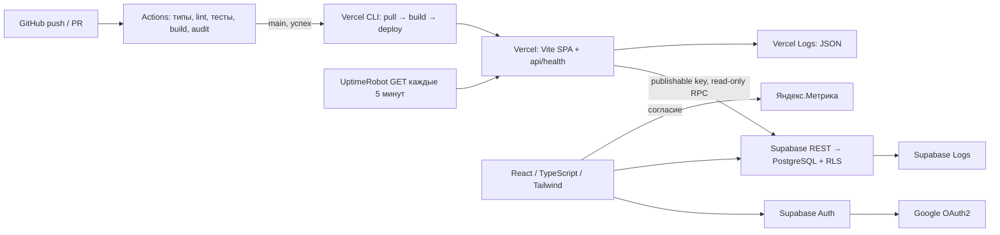

# ДЗ6 — Настройка CI/CD и интеграция сервисов

[Навигация](README.md) · [Запуск](../README.md) · [Аудит](security_audit.md) · [Исходное задание](original.txt)

Дата работы: 15.10.2026, Europe/Moscow. **ДЗ6 ещё не завершено полностью:**
код и локальные проверки отделены от фактического запуска внешних сервисов.
Production URL, Vercel project/org ID, OAuth Client ID и ID Метрики неизвестны.
Значения ниже в угловых скобках — места для подстановки, а не созданные ресурсы.

## 1. Цель и матрица требований

Источник: `original.txt`, раздел «Настройка CI/CD и интеграция сервисов», строки
893–1119. Обязательны шаги 1–4, 6–7, тестирование и артефакты шага 9.
Платежи и необязательная оптимизация исключены по запросу владельца.

| Требование | Реализация | Подтверждение / ограничение |
| --- | --- | --- |
| 1. CI/CD | [workflow](../.github/workflows/ci-cd.yml), Vercel CLI | Команды проверяются локально; GitHub run и production ожидают настройки |
| 2. Аудит | [security_audit.md](security_audit.md), npm audit, проверки RLS | Реальный аудит и live RLS выполнены |
| 3. OAuth2 | AuthService → Google через Supabase Auth, PKCE | SDK/UI тесты; реальный Google-вход ожидает настройки |
| 4. Аналитика | Метрика с согласием, три цели | Тесты вызовов/отказа; реальный счётчик ожидает настройки |
| 6. Мониторинг | `/api/health`, read-only RPC, UptimeRobot | Endpoint/SQL тесты; применение RPC и монитор ожидают владельца |
| 7. Логи | JSON logger, Vercel Logs / Supabase Logs | Проверена схема, учебный анализ ниже; Dashboard Logs недоступны |
| 8–9. Проверки и отчёт | Vitest/RTL, SQL, browser, README, этот файл | Доказательства и незавершённые действия перечислены ниже |

До изменений изучены документы `docs/`, исходное задание, текущие Auth/CRUD,
тесты, миграция, package/lockfile, Vite, Git и имена переменных окружения.
Исходный проект находится **в корне репозитория**, содержит React 18, SDK
Supabase 2.57.4 и полноценный CRUD. Workflow, lint и formatter отсутствовали.
Утверждения ДЗ3 «код ещё не создан», ДЗ4 «только mock» и ДЗ5 «OAuth/lint нет»
являются историческими; старые отчёты сохранены. Нового описания BookTrack нет.
Нынешний SDK сам обрабатывает PKCE callback; отдельный OAuth backend не нужен.

## 2. Архитектура и зафиксированный стек



Node 22 LTS задан в `.nvmrc` и `package.json`; npm, Vite, React, TypeScript,
Tailwind, Vitest/RTL сохранены. Vitest обновлён до 4.1.11, Tailwind до 4.3.3
с `@tailwindcss/postcss` из-за подтверждённых dev-уязвимостей. Изменение CSS
ограничено подключением нового PostCSS plugin/директив; UI проверен в браузере.
ESLint добавлен для обязательного lint. Formatter ранее не был настроен,
поэтому отдельный форматтер ради этапа не добавлен. Других сервисов нет.

## 3. GitHub Actions

`.github/workflows/ci-cd.yml` запускается на любой push, pull request и вручную.
Job `ci`: checkout → Node 22 → `npm ci` → `typecheck` → `lint` → `check:secrets`
→ `npm test` → `test:sql` → production build → `npm audit --audit-level=low`.
Даже low audit issue блокирует pipeline; `continue-on-error` отсутствует.
Live-тесты с паролями и внешними аккаунтами в PR не запускаются.

Job `deploy` имеет `needs: ci`, допускает только `refs/heads/main` и push
либо ручной запуск из main. PR production не разворачивает. Job имеет timeout
и отдельную concurrency group для последовательных production deployments.
Разрешения workflow ограничены `contents: read`. Vercel CLI зафиксирован: 64.2.0.

```sh
npx --yes vercel@64.2.0 pull --yes --environment=production
npx --yes vercel@64.2.0 build --prod
npx --yes vercel@64.2.0 deploy --prebuilt --prod
```

В workflow токен передаётся из secret, значения в коде нет. CLI выводит URL
созданного deployment; `scripts/check-deployment.mjs` проверяет HTTPS 200 для
`/`, `/auth/callback` и `/api/health`, HTML приложения и JSON статуса БД.
Если задана repository variable `PRODUCTION_URL`, дополнительно проверяется
стабильный production-домен. Redirect/неверный JSON/503 завершают job ошибкой.
Неуспешная проверка **после** deploy не откатывает deployment автоматически:
владелец изучает Logs и при необходимости использует Vercel rollback.

## 4. Окружение и секреты

| Имя | Где задать | Назначение |
| --- | --- | --- |
| `VITE_SUPABASE_URL` | `.env.local`, Vercel Production | Публичный HTTPS project URL |
| `VITE_SUPABASE_PUBLISHABLE_KEY` | `.env.local`, Vercel Production | Только `sb_publishable_…`; RLS обязательна |
| `VITE_YANDEX_METRIKA_ID` | `.env.local` при необходимости, Vercel Production | Реальный числовой ID; до создания оставить пустым |
| `VERCEL_TOKEN` | GitHub Actions repository secret | Авторизация CLI |
| `VERCEL_ORG_ID` | GitHub Actions repository secret | Scope проекта |
| `VERCEL_PROJECT_ID` | GitHub Actions repository secret | Проект Vercel |
| `PRODUCTION_URL` | GitHub Actions repository **variable** | Реальный `https://<production-domain>`, без завершающего пути |
| Google Client ID / Client Secret | Только Supabase Google provider | Secret никогда не передавать Vite/GitHub source/frontend |

Все `VITE_*` попадают в клиентский bundle. Это исключительно публичные параметры,
не защищённое хранилище. Health использует те же две публичные Supabase-переменные
из runtime environment Vercel; добавить их именно в Production, затем redeploy.
Ни `service_role`, ни `sb_secret_`, ни Google Client Secret там не требуются.
`.env*`, `.vercel/` и локальные артефакты CLI исключены Git; шаблон — [.env.example](../.env.example).
После изменения Vite env нужна новая сборка, после локального изменения — restart Vite.

## 5. Ручная настройка сервисов

Порядок учитывает зависимости между production URL, OAuth и счётчиком.
Ниже действия владельца, которые агент не выполнял в Dashboard.

### 5.1. Создать Vercel project и получить URL — до настройки OAuth

Перед импортом опубликовать подготовленные изменения в существующем GitHub
репозитории. До добавления Vercel secrets job deploy может ожидаемо остановиться
на Check deployment configuration; после настройки повторить run. Это не
подтверждение успешного CI/CD, и ошибка не скрывается.

1. Открыть [Vercel Dashboard](https://vercel.com/dashboard) → Add New → Project.
2. Импортировать существующий [sergogaset/BookTrack](https://github.com/sergogaset/BookTrack), назвать проект `booktrack`.
3. Framework Preset: **Vite**. Root Directory: **корень (`./`)**, не `src`.
4. Node.js: **22.x**. Install: `npm ci`; Build: `npm run build`; Output: `dist`.
5. **До первого deployment** добавить в Production `VITE_SUPABASE_URL` и
   `VITE_SUPABASE_PUBLISHABLE_KEY` из уже существующего проекта Supabase.
   Поле Метрики пока можно оставить пустым. Не создавать второй Supabase project.
6. Нажать Deploy для первоначального ручного deployment. Если импорт не запускает
   его из-за `git.deploymentEnabled: false`, выполнить первоначальный deploy из
   корня через `npx --yes vercel@64.2.0 login`, `npx --yes vercel@64.2.0 link`,
   `npx --yes vercel@64.2.0 --prod` и выбрать уже созданный проект `booktrack`.
   Это разовая настройка; последующие production deployments выполняет Actions.
7. Скопировать **фактический Production Domain** из Deployment/Project → Domains.
   Записать здесь после создания: Production URL — **ожидает ручной настройки**.
8. Открыть `/` и напрямую `/auth/callback`, обновить страницу. SPA fallback
   в `vercel.json` исключает `/api/*` и статические assets. Клиентского router
   в исходном MVP нет: библиотека определяется сессией, callback возвращается на `/`.
9. `vercel.json` уже содержит `git.deploymentEnabled: false` для Git-интеграции.
   Проверить, что push не порождает второй Git-based deployment; при необходимости
   отключить Git auto deployments в Project Settings → Git. Не создавать Deploy Hook.
   CLI деплой из Actions продолжает работать. Не отключать необходимые проекту
   защитные настройки аккаунта; для публичного production URL проверить доступность
   без входа в Vercel согласно настройкам проекта.

### 5.2. Google Cloud — после получения production URL

1. Открыть [Google Cloud Console](https://console.cloud.google.com/), создать
   проект **BookTrack OAuth** и выбрать его.
2. Открыть **Google Auth Platform**. В Branding указать BookTrack, собственный
   support email и необходимые contact details. Не использовать вымышленные контакты.
3. Audience: **External**. Если приложение в Testing, добавить используемые
   для проверки Google accounts в Test users. Публикация consent screen — отдельное
   действие владельца; для проверки достаточно разрешённых тестовых пользователей.
4. Clients → Create client → **Web application**, Name: **BookTrack Web**.
5. Authorized JavaScript origins: фактический `https://<production-domain>`;
   для локальной проверки добавить `http://127.0.0.1:5173` и, только если используется,
   `http://localhost:5173`. Origin не содержит пути `/auth/callback`.
6. В Supabase Dashboard → существующий BookTrack → Authentication → Providers
   (в новой навигации может называться Sign In / Providers) → Google скопировать
   **точный Callback URL**. Добавить его в Google Authorized redirect URIs.
   Обычная форма — `https://<project-ref>.supabase.co/auth/v1/callback`, но значение
   нужно копировать из Dashboard, особенно при custom Auth domain.
7. Сохранить OAuth client. Получить Client ID и Client Secret и перенести их
   прямо в Supabase Google provider. Не отправлять в чат, Git или frontend `.env.local`.

### 5.3. Supabase Auth — после создания Google OAuth client

1. Открыть [Supabase Dashboard](https://supabase.com/dashboard), выбрать
   существующий проект BookTrack → Authentication → Providers → Google.
2. Включить Google, вставить Client ID и Client Secret, сохранить.
   Существующий email/password provider и RLS оставить включёнными.
3. Authentication → URL Configuration: Site URL = фактический production origin.
4. Redirect URLs: добавить **точные** значения:
   `https://<production-domain>/auth/callback`, `https://<production-domain>`, `https://<production-domain>/`,
   `http://127.0.0.1:5173/auth/callback`, `http://127.0.0.1:5173`.
   Если используете localhost, добавить отдельно `http://localhost:5173/auth/callback`
   и `http://localhost:5173`. Корневые URL нужны существующему email confirmation flow.
   Не разрешать произвольные preview domains wildcard ради удобства.
5. Нажать «Войти через Google», разрешить доступ тестовому Google account.
   После возврата SDK обменивает `code` и PKCE verifier на сессию; `getUser`
   проверяет восстановленную личность, callback-параметры очищаются, открывается библиотека.
6. Проверить reload, CRUD и «Выйти». Повторить с другим тестовым аккаунтом:
   личные книги первого не видны. При наличии одинакового email Supabase может
   связывать identities: для проверки изоляции нужны **разные** пользователи Auth.
7. Отменить Google consent: увидеть безопасное сообщение, проверить доступность
   email/password входа. Закрытие вкладки Google без redirect не создаёт callback:
   приложение при следующем открытии остаётся работоспособным.

**Два разных redirect:** Google Authorized redirect URI ведёт **в Supabase Auth**.
Supabase `redirectTo`/Redirect URLs ведут **из Supabase в BookTrack** на
`/auth/callback`. Нельзя подставлять production frontend URL вместо callback
провайдера или Supabase callback вместо frontend redirect URL.
Основание: [Supabase Google Auth](https://supabase.com/docs/guides/auth/social-login/auth-google),
[PKCE](https://supabase.com/docs/guides/auth/sessions/pkce-flow).

### 5.4. Яндекс.Метрика — после получения production URL

1. Открыть [Метрику](https://metrika.yandex.ru/), создать счётчик **BookTrack**.
2. Указать фактический production URL, сохранить. Скопировать числовой ID.
3. **Не включать Вебвизор, запись форм и автоматические цели** для личной библиотеки.
   Не включать передачу дополнительных пользовательских данных в Dashboard.
4. Добавить `VITE_YANDEX_METRIKA_ID` в Vercel → Project Settings → Environment
   Variables → Production. При необходимости добавить тот же ID локально в `.env.local`.
5. Goals → добавить три цели типа **JavaScript-событие**, identifiers:
   `book_created`, `book_finished`, `book_deleted` (точное совпадение регистра).
6. Выполнить новый deployment через Actions. До согласия в DevTools Network
   не должно быть запросов `mc.yandex.*`. Нажать «Отказаться» — приложение работает.
7. Через «Настройки аналитики» разрешить аналитику. Убедиться, что `tag.js`
   загружен один раз. Просмотры `/auth` и `/library` отправляются явно через `hit`,
   init использует `defer: true`; StrictMode и повторный render просмотры не дублируют.
8. Добавить тестовую книгу → `book_created`; изменить её статус с reading/want_to_read
   на finished → `book_finished`; подтвердить удаление → `book_deleted`.
   Создание сразу finished отправляет только `book_created`; сохранение уже finished
   не является новой сменой статуса. Отмена/ошибка/неопределённый ответ события не отправляют.
9. Проверить достижения целей в Dashboard. Ad blocker может блокировать запросы:
   это не ошибка CRUD. В событиях нет параметров книги, пользователя, ошибок или email.
   `hit` передаёт только origin + фиксированную виртуальную страницу, без query/hash/referrer.
10. Отозвать согласие через настройки: counter destruct, остановка событий и удаление
    script element. Выбор сохраняется в localStorage; синхронизируется между вкладками.
    После перезагрузки при отказе counter не загружается. Уже переданные данные отзыв
    не удаляет; сторонний счётчик технически получает IP/browser metadata.

Webvisor/clickmap/trackLinks/trackHash отключены кодом. Механизм согласия не является
автоматической гарантией соблюдения законодательства во всех странах.
Даже при сохранённом согласии загрузка блокируется, пока в адресе есть OAuth
callback/code/token: сначала SDK завершает возврат и очищает URL.
Основание: [Метрика для SPA](https://yandex.ru/support/metrica/ru/code/counter-spa-setup),
[параметры init](https://yandex.ru/support/metrica/ru/code/counter-initialize).

### 5.5. Health RPC — до проверки deployment через Actions

В Supabase SQL Editor вручную просмотреть и выполнить **только новую**
[20261015000200_health_check.sql](../supabase/migrations/20261015000200_health_check.sql).
Она создаёт `public.booktrack_health()` со стабильным `SELECT true`, SECURITY
INVOKER и пустым search_path; разрешает только выполнение anon/authenticated.
Таблицы, данные и прежние policies/grants не меняются. Старую миграцию books
повторно не выполнять. Дополнительной БД/таблицы и административного ключа нет.

```sql
begin read only;
set local role anon;
select public.booktrack_health(); -- ожидается true
rollback;
```

Это **ожидаемый** результат ручной проверки; удалённое применение ещё не подтверждено.
Локально миграция проверена на PostgreSQL/PGlite, anon по-прежнему не читает books.

### 5.6. GitHub secrets и первый CI/CD

1. Vercel → avatar → Account Settings → **Tokens**
   ([страница токенов](https://vercel.com/account/tokens)) → создать токен для
   выбранного scope с подходящим сроком. Скопировать сразу в GitHub secret.
2. В корне репозитория выполнить `npx --yes vercel@64.2.0 login`, затем
   `npx --yes vercel@64.2.0 link`, выбрать существующий `booktrack` и правильную команду.
   В локальном игнорируемом `.vercel/project.json` взять `orgId` → `VERCEL_ORG_ID`
   и `projectId` → `VERCEL_PROJECT_ID`. Project ID также находится в Project
   Settings → General, Team/Organization ID — в настройках соответствующего scope.
   Использовать IDs выбранного проекта, не slug и не имена.
3. [GitHub repo](https://github.com/sergogaset/BookTrack) → Settings → Secrets and
   variables → Actions → **Secrets → New repository secret**. Создать ровно
   `VERCEL_TOKEN`, `VERCEL_ORG_ID`, `VERCEL_PROJECT_ID`.
4. В соседнем разделе **Variables** создать `PRODUCTION_URL` с фактическим origin.
   Проверить Vercel Production env из таблицы выше, включая ID Метрики после создания.
5. Опубликовать изменения репозитория. Actions → **BookTrack CI/CD → Run workflow**,
   выбрать `main`; либо сделать обычный тестовый commit в main. Из feature branch
   ручной запуск выполняет только CI. PR проверяет код без production deploy.
6. В Actions открыть run → `ci` и `deploy` → шаг с ошибкой. Ошибка установки,
   типов, lint, тестов, build или audit блокирует deploy. Отсутствующие secrets
   останавливают Check deployment configuration без вывода значений.
7. Проверить Deployment в Vercel и публичный `/api/health`: HTTP 200,
   `{"status":"ok","checks":{"application":"ok","database":"ok"}}`.
   503 до применения RPC — ожидаемая незавершённая настройка, не повод ослаблять RLS.
8. Записать ссылку run и Production URL в таблицу результатов ниже.

Документация: [Vercel с GitHub Actions](https://vercel.com/kb/guide/how-can-i-use-github-actions-with-vercel),
[отключение Git deployments](https://vercel.com/docs/project-configuration/git-configuration).

### 5.7. UptimeRobot — после успешного production Health Check

1. Открыть [UptimeRobot](https://uptimerobot.com/), создать аккаунт и подтвердить email.
2. Add New Monitor → **HTTP(s)**. Friendly Name: **BookTrack Health**.
3. URL: `https://<production-domain>/api/health`; Method: **GET**.
4. Интервал: **5 минут** или минимальный доступный на выбранном бесплатном тарифе.
   Не оформлять платную подписку. Не добавлять OAuth/Authorization headers.
5. Выбрать и подтвердить собственный email в Alert Contacts, привязать к монитору,
   сохранить. Убедиться, что публичный URL возвращает HTTP 200 и монитор показывает Up.
6. Для проверки доставки использовать доступную функцию тестового alert в интерфейсе.
   Если её нет, создать отдельный временный monitor на заведомо отсутствующий путь
   `/api/health-alert-test` того же домена; сначала проверить, что ответ 404,
   затем дождаться Down email и удалить только этот тестовый monitor.
   Production приложение и Supabase для теста не останавливать.
7. Записать фактические время, статус, URL monitor и результат email ниже.
   JSON Health Check проверяет backend; обычная проверка только `/` этого не делает.

## 6. Health Check и ограничения

[api/health.ts](../api/health.ts) — Vercel Node.js serverless function `GET /api/health`.
Успешное выполнение handler подтверждает доступность serverless части приложения;
реальный GET к `/rest/v1/rpc/booktrack_health` проверяет REST/PostgREST и выполнение
SQL в PostgreSQL, не читая личные записи. Только HTTP success **и** JSON `true`
дают 200; missing env, timeout, HTTP error, неверный JSON/значение дают 503.
Timeout upstream 4 секунды, Vercel maxDuration 10 секунд, redirect upstream запрещён.
Ответ `no-store`, без ключей/URL/stack trace, с новым UUID `X-Request-Id`.
Неподдерживаемые методы не выполняют запрос к БД.

Health не доказывает доступность Google/Метрики, сохранность всех таблиц или
корректность RLS каждого пользователя. Они проверяются отдельно. Deployment
smoke test дополнительно проверяет SPA HTML и callback. Vite dev/preview сами
не запускают `/api` functions: проверять handler через Vitest или на Vercel.
В SQL нет проверки книг по anon: это намеренно сохраняет запрет на личные данные.
Основание: [Vercel Node runtime](https://vercel.com/docs/functions/runtimes/node-js).

## 7. Логирование и диагностика

[shared/logger.ts](../shared/logger.ts): один JSON object на строку, обязательные
`timestamp`, `level`, `event`, `message`, UUID `requestId` для serverless запросов.
Уровни info/warning/error выбирают соответствующий console sink. Сообщения и event
берутся из фиксированного словаря. Нельзя передать raw exception, payload, email,
токен, пароль или заметку; входящий произвольный request ID не копируется.
Клиентские backend warning включены только вне production. Детальных клиентских
логов BookTrack в production нет; браузер может самостоятельно отображать сетевые ошибки.

Vercel → Project → **Logs**: фильтр function `/api/health`, уровень и время;
сопоставить `X-Request-Id` с JSON requestId. Supabase → **Logs** (API/PostgREST,
Auth, Postgres) — отдельный серверный источник. Сопоставлять по UTC времени,
методу/path/status и собственным request IDs Supabase, если доступны: UUID
Vercel не обещает совпадения с ID Supabase. Не экспортировать headers/body с
apikey, Authorization, токенами или личными данными. Дополнительного хранилища логов нет.

**Реальные production Logs недоступны:** Vercel project ещё не опубликован,
права Dashboard Supabase не предоставлены. Live API/RLS результаты доступны
как тестовый отчёт, не как Logs сервиса. Следующий блок — **учебный пример**,
не реальный инцидент и не доказательство работы Vercel Logs:

```jsonl
{"timestamp":"2026-10-15T12:00:00.000Z","level":"info","event":"health_ok","message":"Application and database check passed","requestId":"10000000-0000-4000-8000-000000000001"}
{"timestamp":"2026-10-15T12:05:00.000Z","level":"error","event":"health_failed","message":"Required backend check failed","requestId":"10000000-0000-4000-8000-000000000002"}
{"timestamp":"2026-10-15T12:06:00.000Z","level":"warning","event":"health_method","message":"Unsupported health request method","requestId":"10000000-0000-4000-8000-000000000003"}
```

Промпт для Codex:

```text
Ты диагностируешь BookTrack (Vercel + Supabase). Разбери обезличенные JSONL ниже.
Это учебные данные, не реальный production-инцидент. Дай хронологию, наблюдения,
гипотезы отдельно от фактов и безопасный порядок проверки. Не запрашивай секреты,
не ослабляй RLS, не меняй удалённую БД. Свяжи requestId только внутри источника.
Предложи минимальное исправление после подтверждения причины и повторный тест.
```

**Результат анализа Codex этого примера:** в 12:00 UTC handler и БД отвечали;
в 12:05 обязательная backend-проверка завершилась ошибкой; в 12:06 поступил
неподдерживаемый метод. По этим строкам нельзя отличить timeout, отсутствующую
RPC, ошибку env или upstream HTTP error. Проверить сначала GET/status/requestId,
затем наличие двух env без раскрытия значений и применение новой RPC, затем
Supabase Logs за соответствующее время. Запрос неверным методом сам по себе
не доказывает атаку. После подтверждённого исправления повторить GET и убедиться
в 200 + database ok, затем проверить восстановление UptimeRobot. Реальные
доступные тестовые отчёты показывают PASS RLS; переносить на них гипотезу сбоя нельзя.

## 8. Результаты проверки интеграций

| Проверка | Фактический результат |
| --- | --- |
| `npm ci` | PASS в изолированной `.tools/ci` с теми же package/lockfile на Node 22/npm 10; файлы основной папки заняты dev server |
| TypeScript, ESLint, build | Выполнены локально, exit 0 после исправлений |
| Vitest/RTL | 84 теста в 11 файлах, PASS; настоящий SDK обменивает PKCE code ровно один раз |
| SQL/PGlite | PASS: 37 проверок, включая новую anon RPC и запрет books |
| Live Supabase Auth/CRUD/RLS | PASS: 33 проверки двумя обычными аккаунтами, [отчёт](images/hw6/live-api-results.json) |
| Браузер Edge | PASS: 12 измерений 320/768/1280, Auth/CRUD/XSS/preview; [отчёт](images/hw6/browser-results.json) |
| npm audit | После обновлений: 0 уязвимостей; см. аудит |
| Конфигурации / документация | YAML разобран, main-only/needs проверены, SPA regex исключает API/assets, локальные ссылки разрешаются; `git diff --check` PASS |
| GitHub CI run / deploy | Ожидают ручной настройки; run URL ещё неизвестен |
| Production URL / HTTP smoke | Ожидают ручной настройки |
| Реальный Google OAuth | Ожидает ручной настройки; SDK/UI сценарии тестируются локально |
| Достижение целей в реальной Метрике | Ожидает ручной настройки; ID отсутствует |
| RPC на удалённом Supabase / health на Vercel | Ожидают ручного применения новой миграции и deployment |
| UptimeRobot + доставка alert | Ожидают ручной настройки |
| Vercel / Supabase Dashboard Logs | Ожидают доступного deployment / просмотра владельцем |

Локальная production-сборка и preview не называются опубликованным production.
Скриншоты ДЗ4–ДЗ5 сохранены; новые изображения получены реальным browser script.

## 9. Использование Codex

Работа выполнена по запросу владельца о ДЗ6: изучение исходного задания и
документов, генерация workflow, реализация OAuth/аналитики/health/JSON logger,
обзор OWASP, online npm audit и обновление зависимостей, тесты и документация.
Фактические проблемы npm resolver и занятый dev-порт не скрывались: для npm
использована совместимая среда, browser test запущен на отдельном порту.
Проверки основаны на реальном коде/выводе инструментов; фиктивные уязвимости,
аккаунты, deployment URL, скриншоты или Dashboard-статусы не создавались.
Учебный разбор логов выполнен в разделе 7 и явно отделён от реальных Logs.

## 10. Итоговый чек-лист и оставшийся порядок действий

**Готово и проверено:** код CI-команд, OAuth SDK/UI, analytics consent/events,
health handler и SQL локально, JSON schema, audit/исправления, live RLS,
браузерная регрессия, обязательные документы и README.

**Реализовано, но ожидает ручной настройки:** GitHub Actions/Vercel production,
Google Cloud/Supabase provider, реальный счётчик/цели Метрики, новая RPC удалённо,
UptimeRobot и оповещения, production Logs. Выполнить разделы **5.1 → 5.2 → 5.3
→ 5.4 → 5.5 → 5.6 → 5.7**, затем проверить OAuth, цели, Health и Logs.

**Не выполнено / есть проблема:** фактическое подтверждение работы всех внешних
интеграций отсутствует до этих действий. Это незавершённые критерии сдачи.

- [x] Workflow подготовлен, ошибки не скрывает; deploy main-only после CI.
- [x] Код, автоматические тесты, анализ зависимостей и безопасности выполнены.
- [x] `security_audit.md`, `integration_documentation.md`, README подготовлены.
- [x] JSON logging и учебная демонстрация анализа Codex добавлены.
- [x] Google OAuth и Метрика реализованы без новых бизнес-функций.
- [x] Health Check реализован; UptimeRobot подготовлен к настройке.
- [x] Функции ДЗ4/ДЗ5 проверены; необязательные сервисы не добавлены.
- [ ] Успешный GitHub Actions run: **вставить фактическую ссылку**.
- [ ] Автоматический production deploy / публичный URL: **вставить после проверки**.
- [ ] Google OAuth в production: **зафиксировать дату и результат**.
- [ ] Метрика: consent / три цели / отсутствие PII: **зафиксировать результат**.
- [ ] Health 200 в production и UptimeRobot Up/email alert: **зафиксировать результат**.
- [ ] Реальные Vercel/Supabase Logs просмотрены и обезличены: **добавить наблюдения**.
