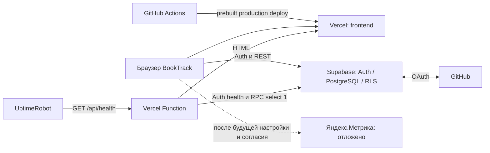

# ДЗ6 — CI/CD и интеграции BookTrack

Дата сверки: **16.10.2026, Москва**. JSON-отчёты используют UTC.
[README](../README.md) · [Все документы](README.md) · [Аудит](security_audit.md).

## 1. Цель и фактический статус

Цель — публиковать существующий BookTrack после автоматических проверок,
добавить OAuth, аналитику, мониторинг, диагностику и аудит без расширения библиотеки.
React + TypeScript + Vite + Tailwind остаются frontend; Supabase — Auth, PostgreSQL и RLS.

По окончательному решению владельца используется **встроенный GitHub OAuth**
в Supabase вместо Яндекс ID. Custom Provider и UserInfo-адаптер не реализовывались.
Это согласованное изменение требований этапа 3; вход по email/password сохранён.

Этап 4 — Яндекс.Метрика — **отложен владельцем**. Реализация сохранена,
но настройка сервиса и доставка событий не подтверждены. Поэтому ДЗ6 целиком
**не завершено**. Итоговые документы этапа 7 подготовлены локально;
их публикация и CI для соответствующего PR ещё ожидаются.

## 2. Архитектура



Книги и авторизация обращаются из браузера прямо в Supabase, поэтому эти запросы
видны в Supabase Logs, а не в Vercel Function Logs. Vercel выполняет `/api/health`.
React Router не используется: экраны входа и библиотеки находятся на `/`.
Обновление страницы восстанавливает сессию и повторно читает личные книги.

Основные файлы: [Auth](../src/data/authService.ts),
[SDK Supabase](../src/data/supabase.ts), [OAuth callback](../src/data/oauthCallback.ts),
[функция](../api/health.ts), [проверки зависимостей](../server/health.ts),
[общий logger](../shared/logger.ts), [Метрика](../src/analytics/metrika.ts).

## 3. GitHub Actions CI/CD

[Workflow](../.github/workflows/ci-cd.yml) запускается для PR в `main`, push в `main`
и вручную. CI: checkout, Node **24**, `npm ci`, `npm run typecheck`, `npm run lint`,
`npm test`, `npm run test:sql`, `npm run build`. Formatter в проекте не настроен,
поэтому отдельного шага форматирования нет. Упавшие проверки останавливают job.
Тесты SQL выполняются локально в PGlite и не изменяют удалённую БД.

Production job зависит от успешного CI и запускается **только при push в main**.
PR и ручной запуск выполняют CI без production-деплоя. В CI-сборке используются
публичные заглушки Supabase; эта сборка не публикуется. Deployment собирается
заново с production-конфигурацией Vercel.

Vercel CLI зафиксирован на **64.2.0**, последовательность:

```sh
vercel pull --yes --environment=production
node scripts/check-deployment-config.mjs
vercel build --prod
node scripts/check-deployment-config.mjs --artifacts
vercel deploy --prebuilt --prod
```

Workflow передаёт токен из защищённого окружения; выше показана последовательность
без секретных значений. GitHub Actions Secrets: `VERCEL_TOKEN`, `VERCEL_ORG_ID`
(идентификатор команды/аккаунта) и `VERCEL_PROJECT_ID`. Права workflow — `contents: read`.
Checkout/setup-node закреплены по commit SHA, credentials checkout не сохраняются.
Нативные Git-деплои Vercel отключены через `git.deploymentEnabled: false` в
[vercel.json](../vercel.json), конкурирующего production-механизма нет.

Подтверждённый push в main: commit `441b8a0c622e944c9f028cea8343ba22fa833d84`,
[run 38822685700](https://github.com/sergogaset/BookTrack/actions/runs/38822685700).
CI и deployment завершились успешно; опубликованный frontend проверен после них.

## 4. Развёртывание на Vercel и окружение

Root Directory — корень репозитория (`.`), preset — Vite, установка — `npm ci`,
Build Command — `npm run build`, Output Directory — `dist`, runtime — Node 24.
Первый импорт GitHub-репозитория дал адрес приложения; дальнейший production CD
выполняет GitHub Actions. Публичный адрес — **https://booktrack-one.vercel.app**.

| Переменная | Где и для чего |
|---|---|
| `VITE_SUPABASE_URL` | Vercel Production / локальный `.env.local`: публичный HTTPS URL Supabase для frontend |
| `VITE_SUPABASE_PUBLISHABLE_KEY` | Там же: публичный ключ `sb_publishable_…`, не service_role |
| `BOOKTRACK_APP_URL` | Vercel Production: `https://booktrack-one.vercel.app`, серверная проверка HTML |
| `SUPABASE_URL` | Vercel Production: URL того же проекта, для серверной функции |
| `SUPABASE_PUBLISHABLE_KEY` | Vercel Production: тот же публичный ключ, для анонимного health RPC |
| `VITE_YANDEX_METRIKA_ID` | Необязательный ID счётчика; пока не настроен, сервис отложен |
| `VERCEL_TOKEN`, `VERCEL_ORG_ID`, `VERCEL_PROJECT_ID` | Только GitHub Actions Secrets для deployment |
| GitHub OAuth Client ID / Client Secret | Настройки провайдера в Supabase Dashboard; secret не передаётся frontend |

Vite подставляет `VITE_*` при сборке, поэтому изменение Dashboard env требует нового
deployment. [Проверка конфигурации](../scripts/check-deployment-config.mjs)
выявляет отсутствующие/неправильные публичные параметры до публикации и проверяет
артефакты после сборки, не печатая значения. Первоначальная ошибка экрана
«Настройка BookTrack» устранена исправлением production env и повторным деплоем.

Имена локальных переменных приведены в [.env.example](../.env.example).
`.env.local`, `.env.integration.local`, `.vercel` и локальный кэш игнорируются Git.
Административных ключей Supabase для этих интеграций не требуется; RLS включён.
Локальная разработка: Node 24, `npm ci`, `npm run dev`, адрес `http://127.0.0.1:5173`.

## 5. GitHub OAuth и Supabase Auth

Кнопка «Войти через GitHub» вызывает
`supabase.auth.signInWithOAuth({ provider: 'github', ... })`. Используются PKCE,
scope `user:email` и `redirectTo: window.location.origin`. SDK получает URL,
затем приложение открывает его; Client Secret в браузере отсутствует.

Владелец создал приложение BookTrack в GitHub Developer Settings и включил
GitHub Provider в Supabase, сохранив Client ID/Secret только в защищённых полях.
Homepage приложения — production URL. OAuth callback, скопированный из Supabase:
`https://fjiuhbiijgwojarorpup.supabase.co/auth/v1/callback`.
Этот адрес возвращает пользователя **из GitHub в Supabase**.

Supabase Site URL — `https://booktrack-one.vercel.app`.
В Redirect URLs разрешены production origin и локальные origins
`http://localhost:5173` / `http://127.0.0.1:5173`.
Это адреса возврата **из Supabase в BookTrack**; они отличаются от callback провайдера.

SDK обменивает callback code на сессию при инициализации; приложение ждёт завершения,
очищает служебные callback-параметры URL и проверяет восстановленную личность через
`getUser()`. Ошибки и отмена показываются безопасными сообщениями, без токенов
и исходных provider-ошибок. `persistSession`, `autoRefreshToken` и подписка Auth
поддерживают восстановление/смену сессии. Выход с `scope: 'local'` завершает
сессию текущего браузера и очищает личный интерфейс.

Владелец подтвердил реальный GitHub-вход, библиотеку, сохранение после обновления,
выход и изоляцию от другого аккаунта. Успешный вход в Supabase Auth Logs также
подтверждён владельцем. Автотесты callback и SDK дополняют эту ручную проверку,
но не подменяют реальный OAuth consent.

Email/password сохранён. Публичные настройки Supabase показывают
`mailer_autoconfirm=true`: подтверждение email отключено. Владелец явно отложил
почтовую настройку и тесты; регистрационные и восстановительные письма не отправлялись.
Это открытый риск SEC-03, а не доказательство успешной доставки почты.

## 6. Личная библиотека и RLS

Существующая [миграция books](../supabase/migrations/20261015000100_create_books.sql)
сохраняет ограничения полей, права столбцов и политики владельца `auth.uid()`.
Frontend не является границей доступа: реальные запросы двух обычных пользователей
подтвердили запрет чтения/изменения чужих строк, подмены владельца и анонимного CRUD.
В ДЗ6 структура books и её RLS не изменялись.

[33 live-проверки API/RLS](audit/live-rls-checks.json) прошли на реальном Supabase;
37 локальных SQL-проверок дополнительно проверяют миграции/права в PGlite.
Локальный тест JWT accessor имитируется и отдельно не доказывает удалённый RLS.

## 7. Яндекс.Метрика — отложено

Код и тесты сохранены. Без корректного `VITE_YANDEX_METRIKA_ID` счётчик не загружается;
даже с ID загрузка разрешена только после согласия на необязательную аналитику.
Есть отказ и отзыв согласия; отзыв уничтожает счётчик, удаляет script и очередь.
Согласие сохраняется локально и синхронизируется между вкладками.

Учёт SPA использует ручные просмотры логических экранов auth/library с устранением
повторов. Передаются фиксированные URL без query/callback и фиксированные заголовки.
Webvisor, clickmap, ecommerce и автоматические дополнительные сборы отключены.
События отправляются только после успешного действия:

| Событие | Условие |
|---|---|
| `book_created` | Книга успешно создана |
| `book_finished` | Успешный переход в finished либо создание сразу finished |
| `book_deleted` | Успешное удаление |

Payload не содержит книги, заметки, email, user ID или токены.
17 тестов модуля, 2 теста согласия и 3 сценария App входят в общий набор.
Финальный браузерный прогон подтвердил **0 запросов к Яндексу** при текущем
отключённом состоянии. Реальный счётчик, три JavaScript-цели, согласие с активным
счётчиком, доставка просмотров/событий и отзыв в production **не проверены**.
Этап требует отдельного возвращения к настройке после решения владельца.

## 8. Health Check и UptimeRobot

`GET /api/health` — публичная Vercel Serverless Function без пользовательской сессии.
Успех: HTTP 200, JSON `status: "ok"`, checks `app`, `supabaseAuth`, `database` = `up`.
Критическая недоступность или неверное окружение: HTTP 503, без деталей секретов.
Поддержан HEAD; другие методы возвращают 405. Ответы не кэшируются.

Три параллельные проверки: HTML приложения с root/assets, Supabase Auth health
и анонимный `GET /rest/v1/rpc/booktrack_health`, возвращающий строго число 1.
Общий дедлайн — 5 секунд с отменой запросов; зависшая зависимость не удерживает ответ.
Адреса берутся из проверенных server env, входящие Host/URL не задают цели запросов.

[Миграция health](../supabase/migrations/20261016000100_health_check.sql) применена
владельцем. Функция SQL выполняет только `select 1`, SECURITY INVOKER,
пустой search_path; EXECUTE разрешён anon/authenticated. Она не читает books
и не ослабляет RLS. Проверка БД не выгружает пользовательские данные.

Успех, недоступность, дедлайн и безопасные ответы покрыты тестами. Отдельный тест
запускает скомпилированный ESM handler в настоящем Node-процессе. Ранее deployment
прошёл, но функция падала из-за extensionless import; исправление `.js` в импорте
устранило ошибку, [run 38819514037](https://github.com/sergogaset/BookTrack/actions/runs/38819514037)
и последующие production-проверки успешны.

Владелец настроил UptimeRobot: **BookTrack Health**, HTTP(s),
`https://booktrack-one.vercel.app/api/health`, интервал 5 минут, email-оповещения.
Он подтвердил состояние **Up и получение обоих писем Down/Up**.
Закрытый Dashboard агентом не читался; доказательство настроек/доставки — ручное
подтверждение владельца. Публичная status page не предоставлялась.

## 9. JSON-логи и анализ с Codex

Собственные записи: `timestamp`, `level` (`info`, `warning`, `error`), `event`,
`message`, а для серверных запросов — UUID `requestId`, совпадающий с `X-Request-Id`.
Event/message заданы каталогом, дополнительные поля разрешены явно:
operation/category, status/durationMs, фиксированные checks и reason.
Произвольные Error/stack, headers, URL, пароли, токены, email и содержимое книг
не сериализуются. UUID создаёт сервер, клиентский request ID не принимается.

| Источник | Фактическая проверка |
|---|---|
| Vercel Function Logs | Владелец увидел JSON info для health и warning для безопасно отклонённого метода |
| Supabase API Gateway | Владелец увидел `booktrack_health` с HTTP 200 |
| Supabase Auth Logs | Владелец увидел успешный вход |
| Frontend backend.failure | Пишется в DevTools Console; пересылки браузерной консоли в Vercel нет |

Vercel/Supabase также создают собственные платформенные записи. Они могут иметь
иной формат и служебные метаданные; сырые экспорты закрытых журналов не публиковались.

Воспроизведение анализа:

```sh
node scripts/analyze-logs.mjs docs/audit/logs.demo.jsonl
node scripts/analyze-logs.mjs docs/audit/logs.local-real.jsonl
```

**Демонстрационные данные:** [logs.demo.jsonl](audit/logs.demo.jsonl), 3 синтетические
записи: по одной info/warning/error. [Анализ](audit/log-analysis-demo.json)
выявляет искусственный тайм-аут database при доступных app/Auth; это не инцидент production.
**Реальные данные:** [logs.local-real.jsonl](audit/logs.local-real.jsonl), один локальный
запуск скомпилированной функции с настоящими зависимостями, info/200, три checks up.
[Анализ](audit/log-analysis-local-real.json) — отдельный результат, не экспорт Vercel.

Codex действительно запускал анализатор и сопоставлял результаты с кодом.
Воспроизводимый запрос, интерпретация и правила обезличивания приведены в
[аудите](security_audit.md). Анализатор выводит только счётчики разрешённых событий,
не повторяет исходные сообщения/идентификаторы и отвергает неверный JSONL.

## 10. Безопасность и оставшиеся риски

В [security_audit.md](security_audit.md) описаны npm audit, применимые категории
OWASP Top 10:2025, XSS, ошибки, Git/env, Auth/OAuth, RLS, заголовки и повторные проверки.

Vitest обновлён до **4.1.11**, исходные critical-записи устранены. Полный audit:
**10 → 7 записей**, теперь 5 high / 2 moderate в dev-цепочке Tailwind 3.
Исправление требует отдельной проверки совместимости; force и опасные overrides
не применялись. Это открытый риск SEC-02 для сборки/CI, а не доказанная атака на приложение.
`npm audit --omit=dev`: **0**. [Финальный повторный audit](audit/final-npm-audit.json)
сохраняет exit code 1 полного аудита и exit code 0 production-аудита.

В production подтверждены nosniff, DENY, no-referrer и частичная CSP
`frame-ancestors 'none'; object-src 'none'; base-uri 'self'`.
Она не ограничивает script-src и не даёт полной защиты от XSS.
React выводит пользовательский текст без исполнения HTML; опасных HTML/eval
в проверенных исходниках не найдено. Сессия в browser storage остаётся риском при XSS.
Подтверждение email отключено (SEC-03); почтовые тесты намеренно пропущены.

Сканирование доступной локальной Git-истории и файлов не обнаружило известных
локальных секретов/выбранных шаблонов. Это ограниченная проверка, не гарантия
для всей удалённой истории. Полного пентеста, проверки всех Dashboard прав,
retention/rate limits и физического мобильного устройства не проводилось.

## 11. Использование Codex

Codex использовался в VS Code для изучения существующих документов/исходников,
подготовки минимальных изменений, workflow, OAuth, отключаемой аналитики,
health, JSON-логов, аудита и этой документации. Проверялись реальные exit codes,
HTTP-ответы, публичные PR/Actions и ограниченные тестовые сценарии с обычными аккаунтами.
Ошибка ESM воспроизведена и исправлена, сетевые неудачи сохранены отдельно от успехов.

Владелец сам настраивал внешние кабинеты, вводил секреты в защищённых полях,
публиковал PR и подтверждал ручные проверки. Codex не получал Client Secret,
административный доступ к БД или сырые приватные журналы.
AI не является компонентом runtime BookTrack; платежи, RAG и fine-tuning в объём не входят.

## 12. Фактическая финальная проверка

| Область | Результат и источник |
|---|---|
| CI/CD main | CI и deploy success, [run 38822685700](https://github.com/sergogaset/BookTrack/actions/runs/38822685700) |
| Локальный код | 112 тестов / 12 файлов; TypeScript, ESLint, production build прошли на Node 24.22.0 |
| SQL | 37 assertions PGlite прошли, включая повторное применение health migration и запрет анонимного books CRUD |
| Реальный API/RLS | 33 проверки, [отчёт](audit/live-rls-checks.json) |
| Публичный UI + реальный Supabase | 15 проверок, [отчёт](audit/final-browser-results.json): email/password, неверный пароль, CRUD, поиск/фильтр, reload, изоляция A/B, выход, 320 px, cleanup |
| GitHub OAuth | Реальный вход/сессия/CRUD/reload/изоляция/выход подтверждены владельцем на этапе 3; успешный вход также виден владельцу в Auth Logs |
| HTTP production | Frontend 200, health 200 / три up, POST health 405, защитные заголовки, [отчёт](audit/production-security-checks.json) |
| Мониторинг | Up, письма Down/Up — подтверждение владельца |
| Логи | Vercel info/warning, Supabase Gateway 200 и Auth login — подтверждение владельца |
| Метрика | 0 Yandex-запросов при отключённой конфигурации; реальная доставка не проверена |
| Аудит | 7 full / 0 production, [JSON](audit/final-npm-audit.json) |

Браузерный прогон использовал сценарий `scripts/browser-live-check.mjs`, адаптированный
**в памяти**: публичный origin вместо local preview, без скриншотов личной библиотеки,
отдельный отчёт в `docs/audit/` и дополнительная проверка отсутствия Yandex-запросов.
HTTP не подменялся. Менялись только новые фикстуры прогона; удаление и отсутствие
этих строк проверены. Пароли брались из игнорируемого `.env.integration.local`
и не печатались. Исторические результаты ДЗ5 сохранены.

Для повторения локальной части на Node 24:

```sh
npm ci
npm run typecheck
npm run lint
npm test
npm run test:sql
npm run build
npm audit --json
npm audit --omit=dev --json
```

Полный audit сейчас ожидаемо возвращает ненулевой код. Live-сценарии требуют
двух выделенных обычных аккаунтов; `npm run test:integration` и
`npm run check:browser:live` по умолчанию записывают исторические пути ДЗ5,
а последний запускает локальный preview. Это не готовые команды проверки production URL.
Финальная проверка реального GitHub consent требует участия владельца.

## 13. Ссылки и ограничения доступа

- [Работающий BookTrack](https://booktrack-one.vercel.app).
- [Публичный Health Check](https://booktrack-one.vercel.app/api/health).
- [Репозиторий](https://github.com/sergogaset/BookTrack).
- [Workflow и история запусков](https://github.com/sergogaset/BookTrack/actions/workflows/ci-cd.yml).
- [PR OAuth](https://github.com/sergogaset/BookTrack/pull/3),
  [PR health](https://github.com/sergogaset/BookTrack/pull/4),
  [исправление ESM](https://github.com/sergogaset/BookTrack/pull/5),
  [PR аудита/логов](https://github.com/sergogaset/BookTrack/pull/6).
- [Supabase Dashboard проекта](https://supabase.com/dashboard/project/fjiuhbiijgwojarorpup): доступ владельца.
- [Vercel Dashboard](https://vercel.com/dashboard): доступ владельца к deployment/env/logs.
- [UptimeRobot](https://uptimerobot.com): монитор доступен владельцу после входа.

Ссылки счётчика Метрики нет: настройка не завершена. Приватные dashboard-ссылки
не заменяют подтверждение владельца, доступ агента к ним не заявляется.
Публичные проверки отражают состояние в момент выполнения, а не гарантию uptime.

## 14. Чек-лист обязательных требований

| Требование | Статус | Основание / что осталось |
|---|---|---|
| Работающий публичный Vercel URL | Готово и проверено. | HTTP и реальный браузер |
| CI: установка, TS, lint, тесты, build | Готово и проверено. | Workflow и успешные PR/main runs |
| Форматирование, если formatter есть | Готово и проверено. | Formatter отсутствует; условие неприменимо, причина указана в workflow |
| Автоматический production CD main | Готово и проверено. | Vercel CLI pull/build/deploy, нативный Git deploy отключён |
| GitHub OAuth через Supabase вместо Яндекс ID | Готово и проверено. | Согласованная замена; реальная проверка владельца, Google OAuth в коде отсутствует |
| Существующий email/password вход | Готово и проверено. | Реальный браузер и API; почтовая доставка сюда не включена |
| Сессия, callback, ошибки, выход | Готово и проверено. | Автотесты и реальные вход/reload/logout |
| CRUD и RLS | Готово и проверено. | 33 live API/RLS и production UI |
| Код Метрики, согласие, SPA и 3 события | Реализовано, ожидает проверки. | Тесты проходят, нужна проверка с активным счётчиком |
| Счётчик/цели и реальная доставка Метрики | Не выполнено. | Этап отложен владельцем |
| Health Check с БД/timeout/200/503 | Готово и проверено. | Автотесты, безопасный RPC и публичный endpoint |
| UptimeRobot и оповещения | Готово и проверено. | Up и оба письма подтверждены владельцем |
| JSON-логи, Vercel/Supabase Logs | Готово и проверено. | Тесты, HTTP requestId, ручные Dashboard-подтверждения |
| Аудит npm / OWASP и повторная проверка | Готово и проверено. | Аудит выполнен; SEC-02/03 остаются открытыми |
| Устранение всех npm-находок / email-риска | Не выполнено. | 7 dev-находок; почтовой настройки владелец не запрашивает |
| Обезличенный анализ логов с Codex | Готово и проверено. | Отдельные demo и real-local JSONL/анализы |
| Использование AI задокументировано | Готово и проверено. | Раздел 11 и воспроизводимый пример в аудите |
| integration_documentation.md, security_audit.md и README | Реализовано, ожидает проверки. | Файлы подготовлены; публикация итогового PR и его CI ещё ожидаются |

Для завершения обязательного объёма остаются возврат к этапу 4 с реальной проверкой
Метрики и публикация итоговых документов. Открытые риски аудита сохраняются явно;
прошедшие тесты не объявляют их устранёнными.
