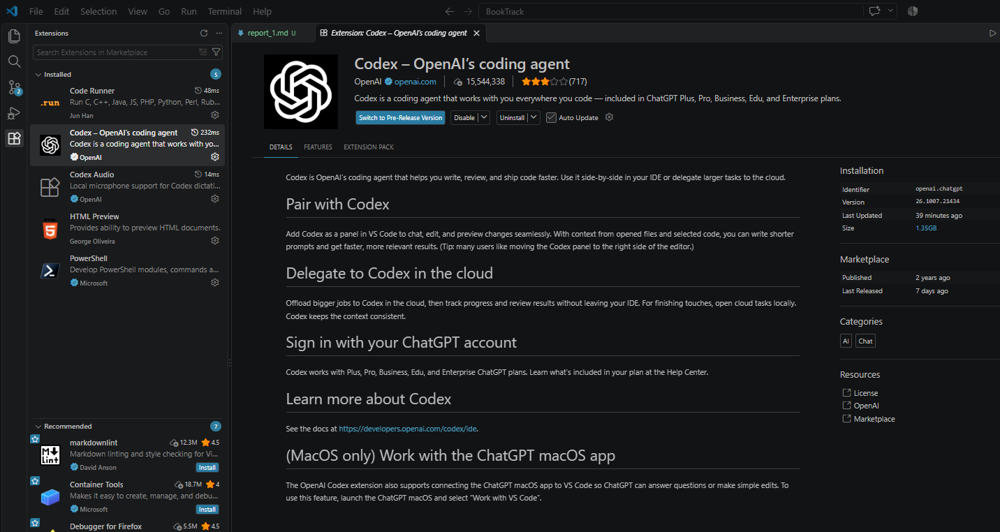
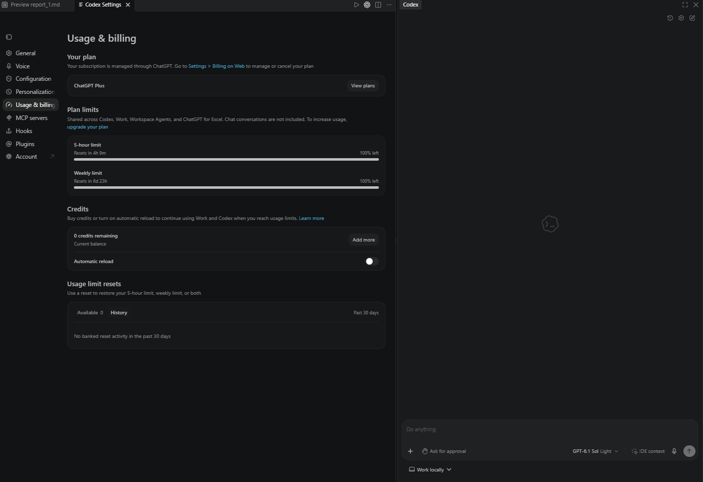
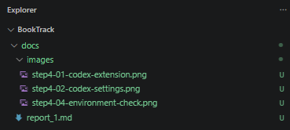
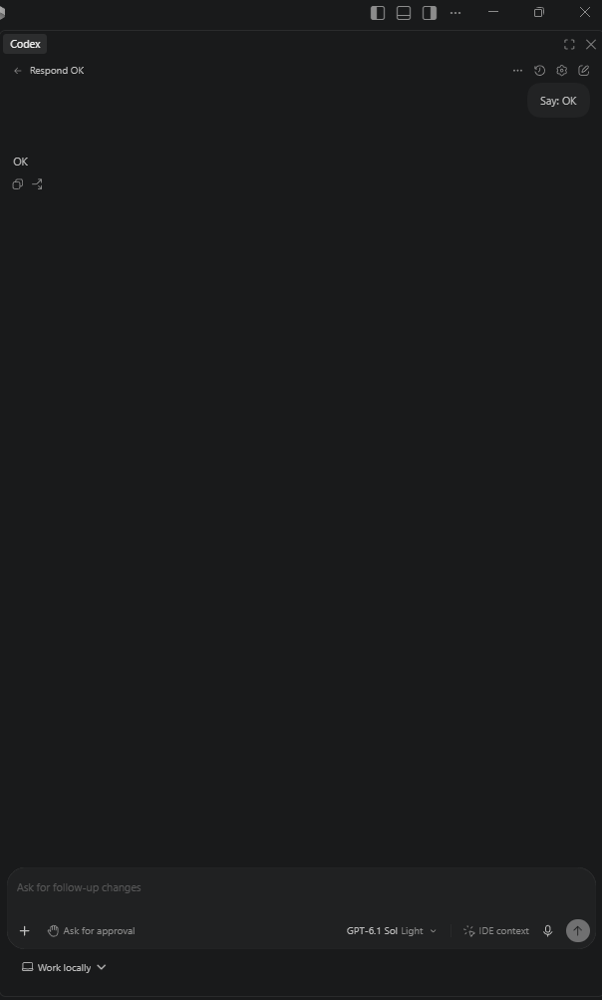

# Отчёт по ДЗ1: сравнительный анализ AI-инструментов для разработки

**Студент:** Смирнов Сергей Сергеевич
**Группа:** 4480
**Дата:** 15.10.2026

## 1. Анализ требований проекта

### 1.1. Описание задачи

Рассматривается разработка **BookTrack** — веб-приложения для ведения личной библиотеки и учёта прочитанных книг. Пользователь сможет добавлять книги, отмечать прогресс чтения и находить записи в своей библиотеке.

Предполагаемые функции приложения:
- добавление, просмотр, редактирование и удаление книг;
- указание названия, автора, жанра, статуса чтения и личной оценки;
- поиск и фильтрация книг по названию, автору и статусу;
- отображение статистики: количество прочитанных книг и книг в процессе чтения;
- регистрация и вход пользователя, изоляция личных записей;
- адаптивный интерфейс, состояния загрузки, пустого списка и ошибок;
- автоматизированные тесты основных сценариев.

**Планируемый технологический стек:** VS Code, OpenAI Codex, ChatGPT; React + TypeScript + Vite для интерфейса; Supabase (PostgreSQL, Auth, RLS) для хранения данных и авторизации; GitHub для версионирования; GitHub Actions и Vercel для последующих этапов проекта. Стек описывает **план**, а не уже реализованную систему.

### 1.2. Ключевые требования и ограничения

| Критерий | Требование проекта |
| --- | --- |
| Сложность | Низкая или средняя: типовой CRUD, фильтры, авторизация и статистика |
| Контекст проекта | Агент должен учитывать связи между компонентами React, типами TypeScript, тестами и конфигурацией |
| Локальные файлы | Нужны чтение и изменение файлов в локальном Git-репозитории через VS Code |
| Качество кода | Читаемые компоненты, типизация, разделение ответственности, тестируемость |
| Безопасность | Не передавать агенту реальные пароли, API-ключи и секреты; обеспечить разграничение доступа к книгам пользователей |
| Бюджет | Желательны доступные начальные тарифы и предсказуемые ограничения использования |
| Работа в России | При необходимости отдельно проверять региональную доступность аккаунта, сервиса и способов оплаты; не предполагать её автоматически |
| Практический сценарий | Проверить Codex на небольшой задаче в BookTrack, зафиксировать запрос, результат и изменения |

## 2. Сравнительный анализ инструментов

### 2.1. Методика

Для сравнения рассмотрены **три облачных агента** (Bolt.new, Lovable, Replit Agent) и **несколько IDE/CLI-агентов** (Cursor, GitHub Copilot, Cline, Claude Code, Gemini CLI, Aider, OpenAI Codex). Это покрывает требование сравнить не менее двух инструментов каждого типа.

Шкала 1–5 отражает **предварительную экспертную оценку пригодности для BookTrack**, а не результаты проведённого бенчмарка: **5 — наиболее подходящее значение**. В графе «Стоимость» 5 означает более доступный или гибко контролируемый сценарий использования; в графе «Контроль данных» 5 означает больше вариантов контроля над отправкой исходного кода. Оценки скорости и качества зависят от модели, лимитов, промпта и сложности задачи.

Следует различать **локально установленного агента** и **локально работающую LLM**: расширение VS Code может запускаться на компьютере, но отправлять запросы облачной модели.

### 2.2. Сравнительная таблица

| Инструмент | Тип | Контекст проекта (1–5) | Скорость (1–5) | Качество кода (1–5) | Стоимость (1–5) | Контроль данных (1–5) | Интеграция (1–5) | Локальный клиент | Локальная LLM | Краткое обоснование |
| --- | --- | ---: | ---: | ---: | ---: | ---: | ---: | --- | --- | --- |
| [Bolt.new](https://bolt.new/) | Cloud | 4 | 5 | 4 | 3 | 2 | 4 | Нет, основной сценарий — браузер | Не основной сценарий | Быстро создаёт прототип интерфейса и приложения, но для дальнейшей работы предпочтительнее собственный локальный репозиторий |
| [Lovable](https://lovable.dev/) | Cloud | 4 | 5 | 4 | 3 | 2 | 4 | Нет, основной сценарий — браузер | Не основной сценарий | Удобен для генерации UI и MVP, но часть рабочего процесса привязана к облачной платформе |
| [Replit Agent](https://replit.com/) | Cloud | 4 | 4 | 4 | 2 | 2 | 4 | Основной сценарий — облачная среда | Не основной сценарий | Среда разработки и запуска в одном сервисе; следует учитывать ограничения и стоимость использования |
| [Cursor](https://cursor.com/) | IDE | 5 | 4 | 5 | 3 | 3 | 5 | Да | Зависит от поддерживаемых провайдеров и версии | Глубокая интеграция с редактором и проектом, но требует перехода с привычного VS Code на отдельную IDE |
| [GitHub Copilot](https://github.com/features/copilot) | IDE/CLI | 4 | 5 | 4 | 3 | 3 | 5 | Да | Зависит от клиента и настроек | Удобен для подсказок и работы в VS Code/GitHub; агентные возможности зависят от режима и тарифа |
| [Cline](https://cline.bot/) | IDE/CLI | 5 | 3 | 4 | 4 | 5* | 4 | Да | Да, с совместимыми локальными провайдерами | Гибкий выбор моделей, включая локальные; требует настройки провайдера и контроля расхода токенов |
| [Claude Code](https://code.claude.com/) | CLI/IDE | 5 | 4 | 5 | 2 | 3 | 4 | Да | Не универсальный штатный сценарий | Подходит для многошаговых изменений и рефакторинга, но добавляет отдельный инструмент и модельный стек |
| [Gemini CLI](https://github.com/google-gemini/gemini-cli) | CLI | 4 | 4 | 4 | 4 | 3 | 3 | Да | Зависит от версии и конфигурации | Открытый CLI, полезный для работы с репозиторием; меньше акцент на визуальном процессе в IDE |
| [Aider](https://aider.chat/) | CLI | 5 | 3 | 4 | 5* | 5* | 3 | Да | Да, через совместимые API | Сильная интеграция с Git и возможность локальных моделей, но терминальный интерфейс менее удобен начинающему разработчику |
| **[OpenAI Codex](https://openai.com/codex/)** | **IDE/CLI/агент разработки** | **5** | **4** | **5** | **3** | **3** | **5** | **Да** | Не считать поддержкой произвольной локальной LLM без проверки конкретного клиента | **Работает с проектом в VS Code, помогает изменять несколько файлов, запускать команды и тесты; хорошо соответствует выбранному рабочему процессу** |

\* Высокие оценки стоимости и контроля данных для Cline/Aider относятся к **корректно настроенному локальному сценарию**. При подключении платной облачной модели характеристики меняются.

**Примечание.** Региональная доступность, тарифы, лимиты, доступные модели и способы оплаты меняются. Перед установкой необходимо проверить актуальные условия на официальных сайтах. Числовые оценки не следует представлять как результаты фактического тестирования: практическая проверка выбранного агента описывается в разделе 5.

### 2.3. Результаты сравнения

1. **Cloud-агенты** Bolt.new, Lovable и Replit Agent удобны для быстрого получения первого прототипа BookTrack. Их преимущество — скорость старта; ограничение — зависимость от облачного рабочего процесса и меньшая прозрачность локального контроля над каждым изменением.
2. **IDE/CLI-агенты** лучше подходят для поэтапного учебного проекта, где требуется показать исходный код, структуру репозитория, тесты, исправление ошибок и историю изменений.
3. **Codex, Cursor и Claude Code** являются подходящими кандидатами для работы с несколькими файлами. Для BookTrack решающее значение имеют не абстрактные рейтинги качества, а удобство работы в выбранной IDE, контроль изменений и возможность повторяемого тестирования.
4. **Cline и Aider** дают гибкость при выборе провайдера и локальных моделей, но потребуют дополнительных решений по конфигурации и качеству конкретной LLM.

## 3. Выбор инструмента

### 3.1. Итоговый выбор — OpenAI Codex в VS Code

Для разработки BookTrack выбран **OpenAI Codex** как основной AI-агент в **Visual Studio Code**. **ChatGPT** используется как дополнительный инструмент для анализа требований, формулирования промптов, обсуждения архитектуры и объяснения результатов; непосредственные изменения кода предполагается выполнять и проверять через Codex и Git.

**Обоснование выбора:**

1. **Сохранение привычной среды разработки.** Codex можно использовать в VS Code без перехода на отдельную IDE. Это снижает время на освоение инструментов и позволяет сосредоточиться на React, TypeScript и функциональности BookTrack.
2. **Работа с контекстом репозитория.** Агент может учитывать связанные файлы проекта: компоненты, типы, стили, тесты и конфигурацию. Это полезно при реализации карточки книги, формы редактирования и фильтрации списка.
3. **Агентный сценарий разработки.** Codex рассчитан не только на автодополнение строк: его можно использовать для анализа задачи, предложения плана, изменения файлов, запуска доступных команд и проверки результатов. Конкретные действия зависят от выбранного режима и разрешений.
4. **Поддержка учебного процесса.** Изменения можно выполнять небольшими итерациями, фиксировать исходный промпт, просматривать diff, запускать тесты и прикладывать скриншоты к отчёту.
5. **Совместимость с планируемым стеком.** Для BookTrack не требуется специализированная интеграция с корпоративными системами: обычный репозиторий React/TypeScript и дальнейшее подключение Supabase подходят для такого рабочего процесса.
6. **Разделение ролей Codex и ChatGPT.** ChatGPT помогает продумать решение и критерии проверки, а Codex применяет согласованные изменения в кодовой базе. При этом ChatGPT не заменяет локальное тестирование.
7. **Контроль изменений и безопасность.** Разработчик может проверять предлагаемые правки перед коммитом, ограничивать опасные команды и исключать секреты из контекста. Поскольку запросы могут обрабатываться в облаке, локальная установка расширения сама по себе не означает локальную обработку кода.
8. **Стоимость.** Использование Codex через существующий аккаунт ChatGPT может быть удобным организационно, но доступность, лимиты и стоимость зависят от текущего плана. Выбор не основан на предположении о безлимитном бесплатном использовании.

**Вывод:** для BookTrack Codex является рациональным выбором прежде всего из-за сочетания VS Code, работы с целым проектом, управляемых изменений и возможности документировать процесс. Это обоснование выбора, а не утверждение о превосходстве Codex во всех задачах.

### 3.2. Альтернативы

- **Cursor** — близкая альтернатива с глубокой AI-интеграцией. Не выбран, поскольку VS Code уже обеспечивает привычную рабочую среду, а Codex позволяет добавить агентные функции без смены редактора.
- **Claude Code** — сильный вариант для многошаговых задач. Не выбран, чтобы не вводить второй основной агент и отдельный рабочий процесс для относительно небольшого проекта.
- **GitHub Copilot** — удобен для подсказок и интеграции с GitHub. Для данного проекта предпочтён Codex как единый основной агент для постановки задач и последовательных изменений.
- **Cline / Aider** — гибкие решения, особенно при необходимости локальной модели. Пока это не является ключевым требованием BookTrack, поэтому дополнительная настройка не даёт очевидного преимущества.
- **Bolt.new / Lovable / Replit Agent** — подходят для быстрого прототипирования, но не выбраны в качестве основной среды, так как в учебном проекте важны работа с локальными файлами, Git и демонстрация последовательных изменений.

## 4. Настройка рабочего окружения

**ОС компьютера разработки:** Windows 11  
**Версия VS Code:** 1.141.2
**Codex:**  Codex – OpenAI’s coding agent 26.1007.21434
**Модель:** GPT 6.1 Sol
**Способ входа:** Аккаунт ChatGPT
**Рабочая папка:** S:\PROJECTS\BookTrack
**Git:** 2.44.0. Репозиторий: https://github.com/sergogaset/BookTrack.git

**Доказательства настройки:**

**Скриншот 4.1 — установленное расширение Codex в VS Code.**  

**Скриншот 4.2 — вход в Codex и доступный режим/модель (без личных данных и ключей).**  

**Скриншот 4.3 — открытый проект BookTrack и структура файлов.**  

**Скриншот 4.4 — дополнительные настройки или проверка работы агента.**  

## 5. Практическое применение: проверка Codex на задаче BookTrack

> **Раздел для заполнения после фактического выполнения задачи.** Предложенный ниже промпт — заготовка для проверки, а не свидетельство уже выполненной работы.

**Цель проверки:** оценить, насколько Codex понимает существующую структуру проекта, предлагает ограниченное изменение и объясняет результат.

**Тестовая задача:** реализация или улучшение фильтрации списка книг по статусу чтения (*«Хочу прочитать»*, *«Читаю»*, *«Прочитано»*) без изменения других функций. Если в проекте ещё нет списка книг, сначала следует создать минимальный прототип и зафиксировать это как отдельный шаг.

**Промпт для Codex:**

> Изучи структуру проекта BookTrack и найди компонент, который отображает список книг. Сначала кратко опиши, какие файлы и типы данных связаны с этим списком. Затем предложи минимальный план добавления фильтра по статусу чтения: «Хочу прочитать», «Читаю», «Прочитано», а также вариант «Все». Не изменяй файлы до моего подтверждения. После подтверждения реализуй фильтрацию с учётом существующего стиля и TypeScript-типов, добавь или обнови тесты, запусти доступные проверки. Не затрагивай авторизацию и базу данных, не добавляй зависимости без согласования. В конце перечисли изменённые файлы, результаты проверок и возможные ограничения.

**Фактически использованный промпт:** [вставить, если отличается от заготовки]  
**Краткое описание ответа агента:** [заполнить после проверки]  
**Какие файлы изменены:** [заполнить]  
**Какие проверки запускались и их результат:** [заполнить]  
**Выявленные ошибки или ограничения:** [заполнить]  
**Итог самостоятельной проверки:** [работает / требует исправлений; пояснение]  

**Доказательства выполнения:**

**Скриншот 5.1 — запрос к Codex и анализ задачи.**  

**Скриншот 5.2 — предлагаемые изменения или diff в VS Code.**  

**Скриншот 5.3 — результат в интерфейсе BookTrack.**  

**Скриншот 5.4 — запуск тестов или другой проверки.**  

## 6. Выводы и рекомендации

### 6.1. Вывод

По результатам **предварительного сравнительного анализа** для учебного проекта BookTrack выбран **OpenAI Codex в VS Code**. Решение обусловлено возможностью работать в привычной IDE, учитывать контекст локального репозитория, выполнять поэтапные изменения и проверять их с помощью Git и тестов. ChatGPT предполагается использовать для обсуждения требований, архитектуры и качества промптов.

Cloud-агенты удобны для быстрого прототипирования, но в рамках последовательного курса с frontend, backend, тестами и CI/CD основной IDE/CLI-агент обеспечивает более контролируемый процесс разработки. При этом итоговую оценку скорости, качества и удобства Codex следует уточнить **после выполнения практической проверки из раздела 5**.

### 6.2. Чек-лист выбора AI-агента и LLM

- [ ] Определить характер задачи: прототипирование, генерация с нуля, изменение существующего кода или отладка.
- [ ] Проверить, как агент читает файлы и получает контекст репозитория.
- [ ] Уточнить, где выполняется модель и какие данные отправляются провайдеру.
- [ ] Проверить политику конфиденциальности, хранения данных и доступные настройки.
- [ ] Уточнить поддерживаемые модели, лимиты, стоимость и региональную доступность.
- [ ] Проверить поддержку нужных языков, инструментов и тестового окружения.
- [ ] Сравнивать агентов на одинаковой небольшой задаче и с понятными критериями.
- [ ] Не включать в запросы пароли, токены, секреты и реальные персональные данные.
- [ ] Просматривать diff перед принятием изменений и коммитом.
- [ ] Запускать тесты и проверять результат в интерфейсе, а не полагаться только на сообщение агента.
- [ ] Фиксировать промпты, скриншоты, ошибки и собственные выводы для отчёта.

### 6.3. Рекомендация для проекта BookTrack

Рекомендуется начать с минимального приложения React + TypeScript: список книг, карточка книги и локальные тестовые данные. Затем поэтапно добавить фильтрацию, формы создания и редактирования, тесты и подключение Supabase. Каждую задачу следует формулировать для Codex с конкретными ограничениями, критериями готовности и требованием объяснить изменения.

**После практической проверки добавить итоговое наблюдение:** [насколько Codex справился с задачей, что пришлось исправить вручную и стоит ли оставить его основным агентом].

## Ссылки

**Официальные сайты инструментов:**
- OpenAI Codex: https://openai.com/codex/
- Документация Codex: https://developers.openai.com/codex/
- Visual Studio Code: https://code.visualstudio.com/
- ChatGPT: https://chatgpt.com/
- Bolt.new: https://bolt.new/
- Lovable: https://lovable.dev/
- Replit: https://replit.com/
- Cursor: https://cursor.com/
- GitHub Copilot: https://github.com/features/copilot
- Cline: https://cline.bot/
- Claude Code: https://code.claude.com/
- Gemini CLI: https://github.com/google-gemini/gemini-cli
- Aider: https://aider.chat/

**Репозиторий проекта BookTrack:** https://github.com/sergogaset/BookTrack.git
