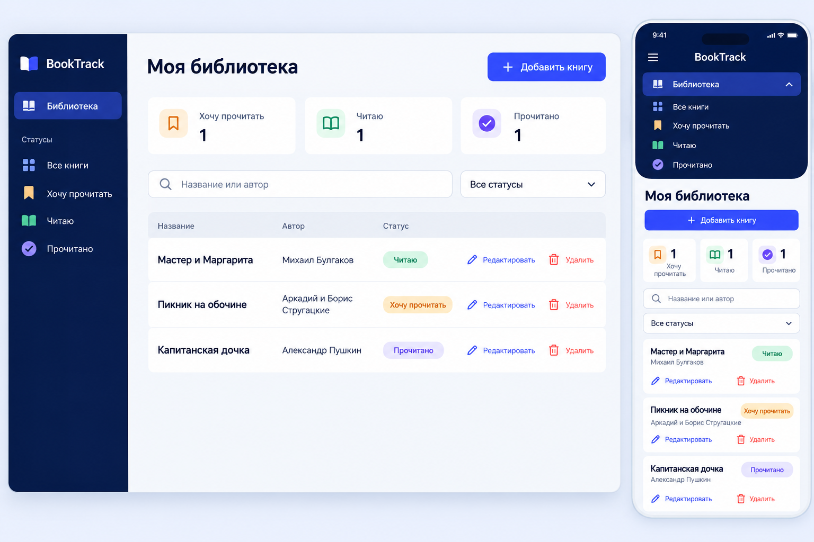
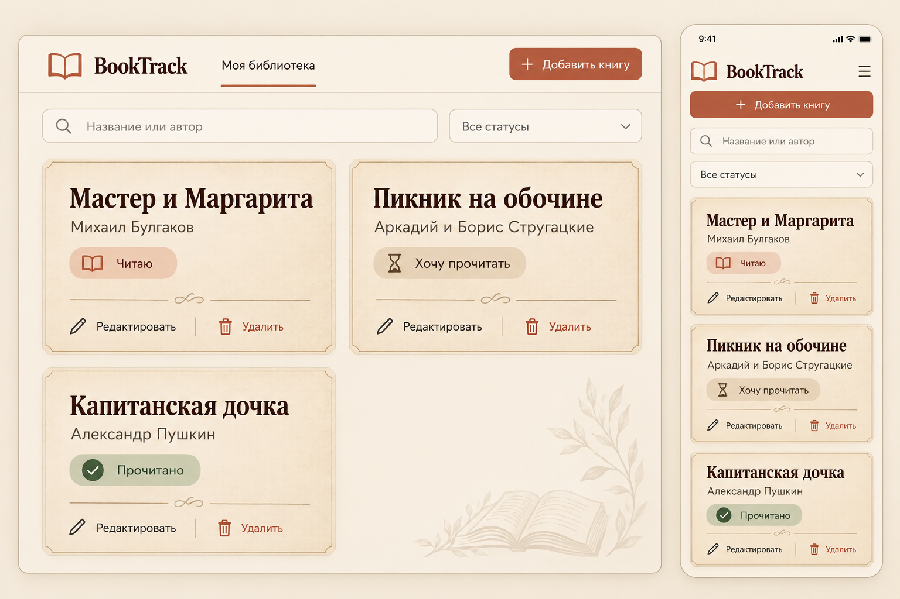

# BookTrack — три UI-концепции

[Навигация](../README.md) · [Продукт](../project_description.md) · [Истории](../user_stories.md) · [ТЗ](../technical_specification.md)

## Статус и способ создания

15.10.2026 встроенным инструментом `image_gen.imagegen` через оркестрацию `functions.exec` созданы три настоящих PNG. Применён навык imagegen; каждый вариант получен отдельным вызовом по текстовому описанию, без входных референсов. Результаты скопированы из каталога генератора в эту папку и визуально просмотрены через `view_image`. HTML, приложение, зависимости, специализированные сервисы Galileo/v0 и браузерные скриншоты не использовались. Это AI-макеты, а не доказательство работающего интерфейса или пользовательского тестирования.

Каждый PNG объединяет desktop и mobile. Все варианты показывают BookTrack, три книги с названиями и авторами, текстовые статусы, поиск, фильтр, добавление, редактирование и удаление. Смена статуса предполагается через форму редактирования. Подтверждение удаления, форма и состояния ошибок описаны в ТЗ, не выдаются за отдельные сгенерированные экраны.

## 1. Minimal Library — минималистичная библиотека

[Открыть PNG](concept_01_minimal.png). Статус: создан, визуально проверен.

Стиль: белый фон, мягкие серые границы, спокойный бирюзовый акцент, простой шрифт без засечек. Компоновка: верхняя шапка BookTrack и «Добавить книгу», под ней поиск и фильтр; на desktop три карточки в ряд. Каждая карточка показывает название, автора, текстовый статус и действия «Редактировать»/«Удалить».

Преимущества: короткий путь к книге, мало визуального шума, хорошо видны подписи действий, небольшое число компонентов. Доступность проще обеспечить за счёт обычных полей и кнопок; статус не зависит только от цвета.

Недостатки: на большой библиотеке карточки занимают больше места, чем строки; серые подписи и границы требуют проверки контраста. Счётчиков нет, что допустимо для MVP.

Desktop: адаптивная сетка по доступной ширине. Mobile: одна колонка, поиск и фильтр друг под другом, действия остаются в карточке. Пиксельные размеры изображения не задают CSS-breakpoints; проверка 320/768/1280 относится к будущей реализации.

## 2. Reading Dashboard — панель чтения

[Открыть PNG](concept_02_dashboard.png). Статус: создан, визуально проверен.

Стиль: насыщенный индиго, тёмно-синяя боковая панель, светлая рабочая область, цветные метки. Компоновка: desktop-sidebar с библиотекой и статусами, три компактных счётчика по одной книге, поиск и фильтр над плотным списком. В строках есть название, автор, статус и оба действия. Навигация по статусам фильтрует ту же библиотеку, не создаёт новые разделы продукта.

Преимущества: компактный список, быстрый обзор количества книг по статусам, хорошо различимая иерархия. Счётчики считаются по полной загруженной библиотеке до применения поиска и фильтра; это не аналитическая подсистема.

Недостатки: sidebar и select частично дублируют фильтрацию, больше состояний и затрат на mobile-навигацию. При большом количестве длинных названий нужны переносы и достаточная ширина действий.

Desktop: sidebar и список. Mobile: панель превращается в раскрываемую верхнюю навигацию с кнопкой меню; на изображении показан раскрытый вариант. Список становится карточками, счётчики компактными. В реализации меню должно сообщать expanded-состояние и работать с клавиатуры; изображение этого не проверяет.

## 3. Cozy Bookshelf — уютный книжный каталог

[Открыть PNG](concept_03_cozy.png). Статус: создан, визуально проверен.

Стиль: кремовые и бежевые поверхности, коричневый текст, терракотовый акцент, выразительные заголовки с засечками. Крупные карточки напоминают бумажный библиотечный каталог. Наверху компактная навигация «Моя библиотека» и добавление, ниже поиск и фильтр. Desktop — две колонки; есть все данные и действия целевого MVP.

Преимущества: выраженный книжный характер, заметные названия, спокойная атмосфера. Чёткая типографическая иерархия помогает отделить книгу от служебных действий.

Недостатки: крупные карточки снижают плотность; орнаменты, текстура бумаги и декоративная иллюстрация книги увеличивают визуальный шум. Они не являются обложками записей и не требуют дополнительных полей, загрузки изображений или внешнего API. В реализации декор можно убрать; он не входит в обязательный MVP. Насыщенность текста и контраст требуют проверки.

Desktop: крупные каталожные карточки. Mobile: одна колонка, верхнее меню компактно, добавление вынесено на полную ширину, поиск и фильтр расположены вертикально. Нужно следить, чтобы выразительный шрифт и длинные названия не вытесняли действия.

## Сравнение

Оценки качественные, по сложности предполагаемой реализации; исследований пользователей и измерений времени не проводилось.

| Критерий | Minimal Library | Reading Dashboard | Cozy Bookshelf |
| --- | --- | --- | --- |
| Компоновка | Верхняя панель + сетка | Sidebar + счётчики + список | Верхняя навигация + крупный каталог |
| Палитра и типографика | Белая, бирюзовый, без засечек | Индиго/синий, плотная | Беж/коричневый, заголовки с засечками |
| Простота | Высокая | Средняя, навигация дублируется | Средняя из-за декора |
| Доступность | Легче обеспечить простыми элементами | Нужны доступное меню и счётчики | Нужна проверка декора, шрифта и контраста |
| Mobile | Прямая перестройка в колонку | Отдельное состояние навигации | Колонка с высокими карточками |
| Трудоёмкость | Низкая относительно остальных | Выше: sidebar и преобразование списка | Средняя: типографика и оформление |
| Соответствие MVP | Полное | Полное, счётчики необязательны | Полное, декор необязателен |

## Выбор для ДЗ4

Выбрана **Minimal Library**. Она покрывает те же семь функций меньшим количеством элементов: библиотека, поиск/фильтр, карточка, общая форма и подтверждение. Простая сетка переносится на mobile без отдельной навигационной системы. Семантические поля и явные действия упрощают доступность и RTL-тестирование. Это оценка реализуемости, а не подтверждённое преимущество по пользовательским метрикам.

Для ДЗ4 сначала реализуются просмотр, добавление и поиск; изображения показывают полный целевой MVP, который завершается в ДЗ5. Подпись «Все статусы» на макете соответствует пункту «Все» в требованиях. Английские названия вариантов — служебные названия концепций, они не обязательны в пользовательском интерфейсе.

## Набор промптов и воспроизведение

Ниже — русский перевод фактически переданных англоязычных промптов с теми же требованиями. Инструмент мог добавить собственную декоративную рамку/изображение устройства; это оформление презентации. Повторная генерация вариативна и не гарантирует совпадение пикселей. PNG сохраняют фактический результат, формулировки требований в ТЗ имеют приоритет при разработке.

### Промпт 1

> Тип: детальный UI-макет. Создать презентацию BookTrack, Minimal Library: широкий холст с desktop и небольшим mobile рядом. Белый фон, мягкие серые границы, спокойный бирюзовый акцент, без обложек и иллюстраций. Desktop: шапка BookTrack, кнопка «Добавить книгу», поиск «Название или автор», фильтр «Все статусы», адаптивная сетка карточек. Точные данные: «Мастер и Маргарита» — «Михаил Булгаков» — «Читаю»; «Пикник на обочине» — «Аркадий и Борис Стругацкие» — «Хочу прочитать»; «Капитанская дочка» — «Александр Пушкин» — «Прочитано». На каждой карточке «Редактировать» и «Удалить». Доступная читаемая типографика, свободное пространство. Mobile: одна колонка, поиск и фильтр вертикально, те же действия. Без социальных функций, диаграмм, ISBN, обложек и дополнительных функций. Статическая концепция, не приложение. Читаемые русские подписи.

### Промпт 2

> Тип: детальный UI-макет BookTrack, Reading Dashboard. Широкое изображение desktop и узкий mobile. Современный насыщенный индиго и тёмно-синий sidebar: BookTrack, «Библиотека», «Все книги», «Хочу прочитать», «Читаю», «Прочитано». Светло-серая основная область «Моя библиотека», «Добавить книгу», три компактных счётчика со значением 1. Без аналитических диаграмм. Поиск «Название или автор», фильтр «Все статусы». Плотный список тех же трёх книг, авторов и статусов, что в промпте 1; в каждой строке «Редактировать» и «Удалить». Цветные текстовые статусы, сине-фиолетовые акценты. На mobile sidebar превращается в верхнее меню с показанной раскрытой навигацией, строки становятся карточками. Читаемый русский текст. Без обложек, друзей, каталога, рекомендаций, дополнительных экранов и платежей. Выраженная плотная компоновка Dashboard.

### Промпт 3

> Тип: детальный UI-макет BookTrack, Cozy Bookshelf. Широкая презентация desktop и небольшого mobile. Тёплый кремовый фон, крупные бежевые карточки бумажного каталога с коричневыми границами; выразительные тёмно-коричневые заголовки с засечками, читаемые элементы управления без засечек. Компактная верхняя навигация BookTrack, «Моя библиотека», «Добавить книгу». Поиск «Название или автор», фильтр «Все статусы». Две колонки больших карточек без обложек. Те же три книги, авторы и статусы, что в промпте 1; на каждой карточке «Редактировать» и «Удалить». Приглушённая терракота, литературная типографика и свободное пространство. Mobile: одна колонка, вертикальные поиск и фильтр, все действия видны. Именно UI-макет, без фотографии устройства, физической полки, вымышленных обложек, социальных и дополнительных функций. Отличается от белой сетки и Dashboard с sidebar. Русский текст.

При визуальном просмотре на всех трёх PNG найдены обязательные элементы и читаемые демонстрационные данные. Генератор добавил презентационные рамки устройств, а в Cozy — книжный декор; эти детали не становятся требованиями приложения. Проверки кликов, клавиатуры, реальной адаптивности и автоматические UI-тесты не проводились, поскольку изображения статичны.